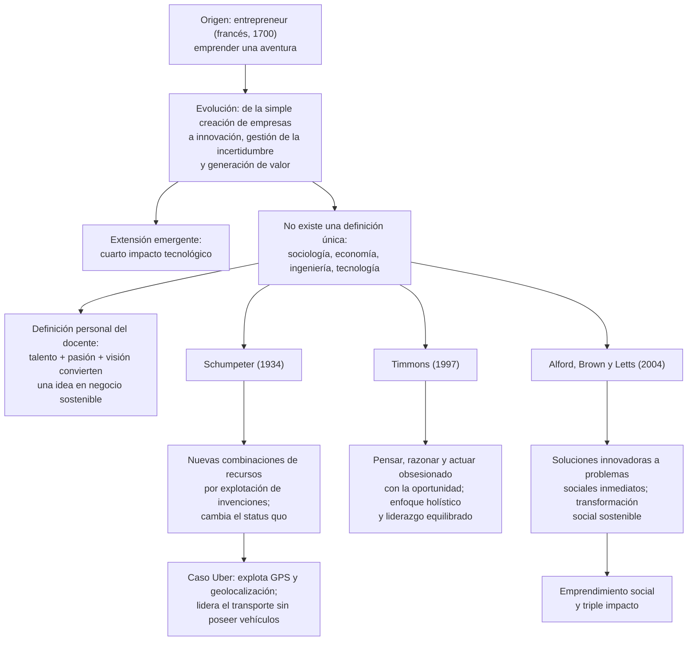
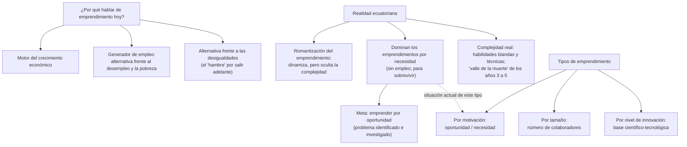
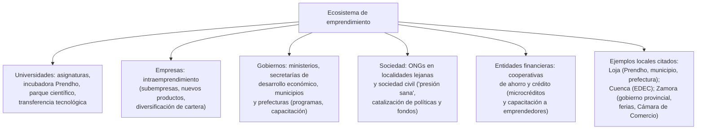
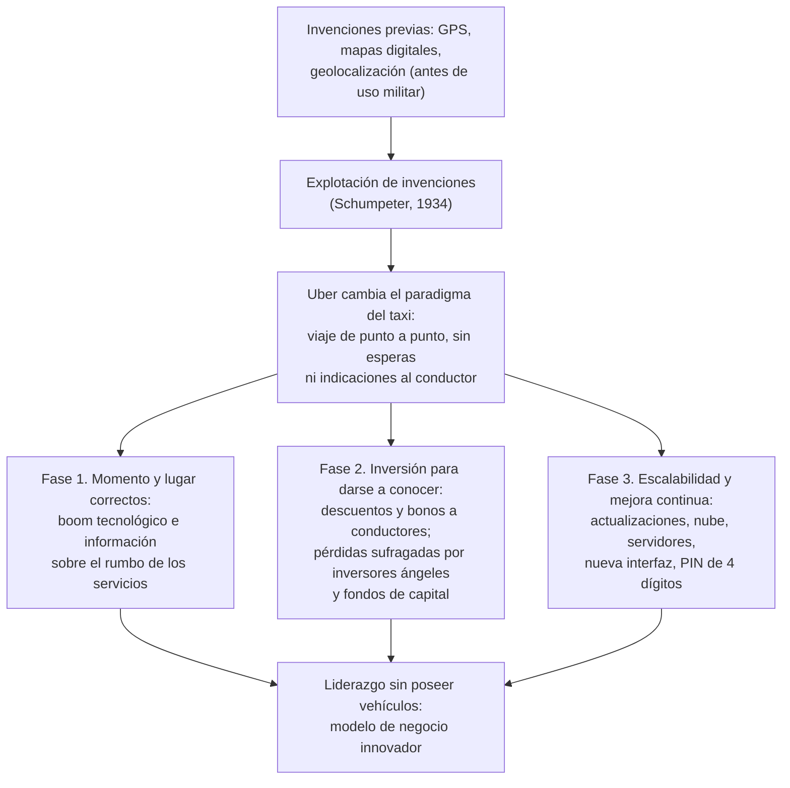

# Semana 1 — Fundamentos del emprendimiento: concepto, origen, tipos y ecosistema

> **Convención de fuentes:** salvo indicación contraria, el contenido proviene del transcript de la sesión. Se marca **[D]** lo aportado por las diapositivas/notas de la semana, **[P]** lo aportado por el documento «Pregunta clave Uber y Airbnb» e **[I]** las inferencias o conexiones propias.

## Síntesis ejecutiva

La primera sesión del curso (C11, UTPL) tuvo tres objetivos: comprender conceptos básicos del emprendimiento, conocer su origen, evolución y tipos, y reconocer la importancia de la innovación y la sostenibilidad. La tesis central es que **no existe una definición única** de emprendimiento (se mira desde la sociología, la economía, la ingeniería y la tecnología) y que cada estudiante debe construir la suya; el docente propuso como definición de trabajo la **fusión de talento, pasión y visión** que convierte una idea innovadora en un negocio sostenible. El concepto evolucionó desde la simple creación de empresas hacia la innovación, la gestión de la incertidumbre y la generación de valor económico, social y ambiental (con un cuarto impacto tecnológico emergente), con tres definiciones de referencia: Schumpeter (1934), Timmons (1997) y Alford, Brown y Letts (2004). El caso Uber ilustró la «explotación de invenciones» y un modelo de éxito en tres fases: momento tecnológico correcto, fuerte inversión en darse a conocer (descuentos, bonos, inversores ángeles) y escalabilidad con mejora continua. Se advirtió la **romantización del emprendimiento en Ecuador** —donde domina el emprendimiento por necesidad— y se presentó el **ecosistema de actores** (universidades, empresas, gobiernos, sociedad) con ejemplos locales.

## Ideas esenciales

### 1. No existe una única definición de emprendimiento
- **Idea:** En el ecosistema actual no hay un solo concepto ni una sola definición: el emprendimiento puede mirarse desde la sociología, la economía, la ingeniería y la tecnología. El resultado de aprendizaje buscado no es memorizar una definición, sino que cada estudiante **construya la suya**.
- **Por qué importa:** Evita una visión dogmática y explica por qué coexisten definiciones académicas tan distintas (idea 5).
- **Relaciones:** Fundamenta la definición de trabajo (idea 2) y se alimenta de la dependencia del contexto (idea 3); la evolución histórica (idea 4) explica cómo se llegó a esta pluralidad.
- **Ejemplo o evidencia:** Las respuestas de los alumnos ya la reflejaban: crear y promocionar un producto, sea en alimentos, artesanía o tecnología (Laura, Contabilidad); «lanzarse al ruedo» y arriesgarse en el mundo empresarial real (Leonidas); materializar una idea organizando el trabajo (Katiuska, ejemplo de la mermelada); emprender delimitado por la localidad y la necesidad social (Sadán); valor del grupo de apoyo (Marco, intervención parcialmente inaudible).

### 2. Definición de trabajo: talento + pasión + visión
- **Idea:** El emprendimiento es la **fusión de talento, pasión y visión**, donde se transforma una idea innovadora en un negocio sostenible. Implica conectar campos diferentes para descubrir nichos, resolver problemas insatisfechos y generar valor, usando el ingenio no solo al inicio sino en todas las fases del negocio. La imagen de la sesión: el emprendimiento nace donde se cruzan talentos y pasiones.
- **Por qué importa:** La pasión sostiene el compromiso (emprender en algo que no se gusta predice el abandono; «el emprendimiento debe causar más felicidad»), y el talento —habilidades, capacidades y conocimiento técnico acumulado desde la escuela hasta el posgrado— hace que el negocio llegue más lejos.
- **Relaciones:** Operativiza la pluralidad (idea 1); dialoga con el enfoque holístico de Timmons (idea 5) y con la motivación por oportunidad (idea 10).
- **Ejemplo o evidencia:** Emprender en tecnología sin que guste la tecnología → querer dejar el negocio a los pocos meses; emprender en deportes que apasionan → felicidad constante con el producto o servicio.

### 3. Emprender en contexto y con herramientas, no solo con audacia
- **Idea:** (a) El emprendimiento **depende del contexto**: no es lo mismo emprender en Ecuador que en Australia (realidades, motivos y procesos de innovación distintos); entender el contexto permite generar productos y servicios verdaderamente innovadores para los usuarios. (b) Asumir riesgos distingue al emprendedor, pero «lanzarse al vacío» **requiere herramientas adecuadas**; materializar una idea exige, además del equipo, acción económica, conocimiento técnico y capacidades.
- **Por qué importa:** Corrige dos extremos: la parálisis teórica y el activismo sin método; además, desmonta el mito de la soledad: el emprendedor «solo» casi siempre tiene red (familia, amigos) que conviene cultivar para desarrollar el producto y escalar.
- **Relaciones:** Anticipa la advertencia sobre la complejidad real (idea 7) y el aporte de herramientas del curso; el contexto explica qué cuenta como «innovador» en cada lugar.
- **Ejemplo o evidencia:** Aportes de Sadán (emprender según localidad, necesidad social, proveedores y personas necesarias) y de Marco (grupo de apoyo); respuesta del docente sobre la supuesta soledad del emprendedor ecuatoriano.

### 4. Origen y evolución del concepto
- **Idea:** El término proviene del francés *entrepreneur* (1700): **emprender una aventura, un viaje, algo que se quiere**. La definición moderna, según expertos y académicos en constante evolución, pasó de la simple creación de empresas a un concepto centrado en la **innovación, la gestión de la incertidumbre y la generación de valor** (económico, social y ambiental) mediante la **identificación de oportunidades**. Algunos ya hablan de un **cuarto impacto: el tecnológico**.
- **Por qué importa:** Evita reducir el emprendimiento a «montar una empresa» y sitúa la discusión actual (innovación, incertidumbre, valor, sostenibilidad).
- **Relaciones:** La maduración histórica se refleja en las tres definiciones (idea 5); el cuarto impacto conecta con el auge tecnológico del caso Uber (idea 6).
- **Ejemplo o evidencia:** El propio recorrido de la sesión: de las respuestas iniciales («crear empresa», «crear un negocio a partir de una idea») a la definición moderna.

### 5. Tres definiciones de referencia

| Autor                            | Definición                                                   | Énfasis                                                      |
| -------------------------------- | ------------------------------------------------------------ | ------------------------------------------------------------ |
| **Schumpeter (1934)**            | El emprendimiento genera nuevas combinaciones de recursos mediante la **explotación de invenciones**, dando como resultado un producto innovador que se puede vender en el mercado | Económico-innovador; rompe el status quo y produce disrupciones trascendentes en el modo de vivir |
| **Timmons (1997)**               | Una **forma de pensar, razonar y actuar** obsesionada con la oportunidad, con enfoque holístico y liderazgo equilibrado | La oportunidad como diferencial; algo sistemático y escalable; pasar de emprendimiento a empresa |
| **Alford, Brown y Letts (2004)** | Proceso que crea **soluciones innovadoras a problemas sociales inmediatos**, movilizando ideas, capacidades, recursos y acuerdos sociales para una transformación social sostenible | Social; base del emprendimiento social y de triple impacto   |

- **Idea:** Las tres definiciones (resumidas en la tabla) marcan la evolución del énfasis: del económico-innovador, a la oportunidad y el liderazgo, y al impacto social.
- **Por qué importa:** Ofrecen un marco teórico para leer casos distintos; el objetivo declarado es pasar de «emprendimiento» a «empresa» (no quedarse con 3–4 trabajadores), lo que Timmons marca con claridad.
- **Relaciones:** Schumpeter se ilustra con Uber (idea 6); Timmons conecta con la definición talento+pasión+visión (idea 2); Alford et al. con la sostenibilidad y el triple impacto (idea 11).
- **Ejemplo o evidencia:** Leonidas señaló identificarse más con Timmons; el docente destacó de Timmons la obsesión por la oportunidad y el liderazgo equilibrado para trabajar con múltiples equipos.

### 6. Caso Uber: explotación de invenciones y tres fases de éxito
- **Idea:** Uber ilustra a Schumpeter: **explotó invenciones ya existentes** (GPS, Google Maps, geolocalización —hasta entonces de uso prácticamente militar—) para liderar el transporte tipo taxi y cambiar el paradigma: pedir un viaje de punto a punto sin esperar 10–15 minutos en la calle ni guiar al conductor. Luego sumó comodidad y seguridad hasta ser líder **sin poseer vehículos**, mediante modelos de negocio innovadores. El docente estructuró el éxito de Uber (y de plataformas nacidas en el mismo boom, como Airbnb y Spotify) en **tres fases**:
  1. **Momento y lugar correctos:** nacieron con el boom tecnológico, con mucha información sobre hacia dónde iban los servicios, y fueron de las primeras.
  2. **Inversión para darse a conocer:** durante años perdieron dinero, sufragado por inversores ángeles y fondos de capital; Uber ofreció descuentos (30–60 %) para que la gente conociera el servicio y percibiera tiempo, comodidad y seguridad, y premió a los conductores (bonos por carreras completadas y extras por más de 5 horas seguidas).
  3. **Escalabilidad con mejora continua:** una vez familiarizados, los clientes no cambian de producto fácilmente, pero hay que mantenerse a la vanguardia: actualizaciones, espacio en la nube, nuevos servidores, nuevas interfaces (p. ej., el candado **PIN de 4 dígitos** antes de abordar, apuesta reciente por la seguridad).
- **Por qué importa:** Muestra que innovar no exige inventar desde cero (la clave está en nuevas combinaciones de recursos), y explica el costo real del éxito: pérdidas iniciales, paciencia de inversionistas y mejora continua permanente.
- **Relaciones:** Aplica Schumpeter (idea 5); las fases 2 y 3 dependen del timing de la fase 1; es la respuesta en clase a la pregunta clave Uber/Airbnb (sección Aplicación).
- **Ejemplo o evidencia:** Aporte del alumno Sadán: el taxi ya existía; es el mismo modelo «explotado al máximo»; Uber dio confianza a conductor y pasajero (p. ej., pago garantizado al conductor si el pasajero cancela: no se pierde tiempo ni combustible). Se anunció un formulario para elegir empresas a analizar en próximas sesiones.

### 7. Romantización del emprendimiento, necesidad y valle de la muerte
- **Idea:** Ecuador vive un proceso de **romantización del emprendimiento** (el «emprendedor de la semana» en las noticias, cursos por radio, asignaturas universitarias). Eso dinamiza el ecosistema, pero distorsiona la percepción de dificultad: emprender es un proceso sumamente complejo que exige habilidades blandas, habilidades más fuertes y conocimiento técnico para superar el **«valle de la muerte» de los años 3 a 5**. Además, muchos emprendedores ecuatorianos parten de la **necesidad** (sin empleo, para alimentar a la familia): según datos citados, existen más emprendimientos por necesidad que por oportunidad.
- **Por qué importa:** Marca el tono realista del curso (no se busca asustar, sino advertir) y justifica formarse —identificar, localizar e investigar el problema— antes de emprender.
- **Relaciones:** Motiva la clasificación por motivación (idea 10) y la meta de pasar de la necesidad a la oportunidad; el factor sociológico del «hambre» conecta con las desigualdades (idea 8).
- **Ejemplo o evidencia:** Aporte de Carlos: la falta de empleo como problema del entorno que empuja a emprender. Invitación a revisar el informe sobre emprendimiento en Ecuador (nombre distorsionado en el audio; según las diapositivas, el estudio de referencia es el **GEM**), que se compartirá en una sesión posterior.

### 8. ¿Por qué hablar de emprendimiento hoy?
- **Idea:** Tres razones: (1) es **motor del crecimiento económico** (los países potencian economías, industrias y competitividad; no quedarse atrás); (2) es **generador de empleo** y alternativa frente al desempleo y la pobreza (relevante ante la crisis de empleo ecuatoriana); (3) es **alternativa frente a las desigualdades** sociales. En lo sociológico, algunos emprendedores hablan del «hambre» de salir adelante («cuando uno no tiene hambre no puede emprender»).
- **Por qué importa:** Justifica el curso y las políticas de fomento; conecta el emprendimiento con el desarrollo del país.
- **Relaciones:** Fundamenta el ecosistema de actores (idea 9) y explica el predominio de la necesidad (idea 7).
- **Ejemplo o evidencia:** El contexto ecuatoriano de desempleo y desigualdad discutido en clase.

### 9. El ecosistema: cuatro actores
- **Idea:** El emprendimiento se fomenta desde: (1) **universidades** (asignaturas, incubadora **Prendho**, parque científico y tecnológico con transferencia); (2) **empresas**, vía **intraemprendimiento** (en el audio, «interemprendimiento»): crear subempresas, desarrollar productos y diversificar la cartera mediante pequeños grupos —conocer de emprendimiento también genera valor interno—; (3) **gobiernos** nacional, seccional y local (ministerios, secretarías de desarrollo económico, municipios y prefecturas: programas, capacitación, fomento); (4) **sociedad**: ONGs que fomentan el emprendimiento en localidades lejanas y sociedad civil llamada a ser **catalizadora**: sin «presión sana» no hay programas, capacitaciones ni fondos (ejemplo citado: Zamora Chinchipe).
- **Por qué importa:** El emprendimiento no ocurre en aislamiento; conocer los actores locales es un recurso práctico al emprender (dónde obtener información, apoyo y financiamiento, incluso como egresado).
- **Relaciones:** Operacionaliza el «por qué hoy» (idea 8); los aportes de los alumnos ilustraron el mapa local: **Loja** (universidad, municipio, prefectura, Prendho), **Cuenca** (**EDEC**, empresa de desarrollo económico de la alcaldía), **Zamora** (cooperativas de ahorro y crédito con microcréditos —p. ej., 5.000–10.000 USD para maquinaria e insumos, donde la banca tradicional es complicada—, gobierno provincial, ferias de emprendedores, Cámara de Comercio).
- **Ejemplo o evidencia:** Intervenciones de Marco, Leonidas, Carlos, Laura y Sadán; consejo del docente: generar presión sana para dinamizar los ecosistemas.

### 10. Tipos de emprendimiento
- **Idea:** Clasificación general: **por motivación** (oportunidad vs. necesidad: la oportunidad parte de identificar un problema o necesidad y generar un producto o servicio; la necesidad, de sobrevivir sin empleo); **por tamaño** (según número de colaboradores: el transcript sugiere 2–3 personas para el pequeño y 5–15 para el mayor; **[D]** las diapositivas indican 5–10 para el pequeño —se prioriza el transcript); **por nivel de innovación** (emprendimiento de **base científico-tecnológica**, vinculado a las universidades). **[D]** No todos los emprendimientos son iguales ni persiguen los mismos fines.
- **Por qué importa:** Da vocabulario para diagnosticar emprendimientos y ecosistemas; la meta explícita en Ecuador es **aumentar los emprendimientos por oportunidad**, apoyándose en cursos y herramientas.
- **Relaciones:** La motivación conecta con la romantización (idea 7) y con el «por qué hoy» (idea 8); el nivel de innovación conecta con Schumpeter y el cuarto impacto (ideas 4 y 6).
- **Ejemplo o evidencia:** El contraste planteado en clase: «necesito dar de comer a mi familia, entonces haré rápidamente [sacos]» vs. «parto de un problema, lo localizo, lo identifico, lo investigo y luego emprendo».

### 11. Sostenibilidad y triple impacto
- **Idea:** En el transcript, la sostenibilidad aparece vía Alford, Brown y Letts (transformación social sostenible) y el **triple impacto**: no solo beneficio económico, sino social y ambiental para las siguientes generaciones. **[D]** Las diapositivas completan el panorama con el emprendimiento sostenible en sus dimensiones ambiental, social y económica, con autores clave: Hart y Milstein (1999), Schaltegger et al. (2018), Muñoz y Cohen (2017).
- **Por qué importa:** Amplía la meta del emprendimiento más allá de lo económico y responde al objetivo declarado de la sesión sobre innovación y sostenibilidad.
- **Relaciones:** Cierra el arco evolutivo del concepto (idea 4); el cuarto impacto tecnológico (idea 4) extiende esta lógica.
- **Ejemplo o evidencia:** **[D]** Chocolates Pacari: paga precio justo al pequeño productor (social), rentabiliza el cacao (económico) y recupera y monetiza el cacao ecuatoriano fomentando su consumo y producción (ambiental). Nota del material: «investigar más».

## Mapa conceptual

**Diagrama 1 — El concepto y su evolución**

*Lectura:* de arriba hacia abajo, el término nace como «emprender una aventura» y evoluciona a la definición moderna; de esa evolución se derivan la pluralidad de miradas, la definición de trabajo del docente y las tres definiciones académicas con sus énfasis; Schumpeter desemboca en el caso Uber y Alford et al. en el emprendimiento social y el triple impacto.

**Diagrama 2 — Por qué hoy, advertencia y tipos**

*Lectura:* arriba, las tres razones para hablar de emprendimiento; en el centro, la realidad ecuatoriana (romantización, necesidad dominante y complejidad/valle de la muerte) y su contrapeso (emprender por oportunidad); abajo, la clasificación de tipos. La línea punteada indica que la necesidad es la situación actual del tipo «motivación» en Ecuador.

**Diagrama 3 — El ecosistema de actores**

*Lectura:* el ecosistema se despliega en frentes de actores; el nodo inferior recoge los ejemplos concretos citados por los alumnos durante la sesión.

**Diagrama 4 — Caso Uber: de la invención explotada al liderazgo**

*Lectura:* de arriba hacia abajo, una invención existente (GPS) se explota al estilo schumpeteriano y produce el cambio de paradigma de Uber; las tres fases explican cómo se financió y sostuvo el crecimiento hasta el liderazgo sin poseer vehículos.

## Notas y puntos clave

- **Objetivos declarados de la sesión:** comprender conceptos básicos; conocer origen, evolución y tipos; reconocer la importancia de la innovación y la sostenibilidad.
- **Equipo docente:** conductor: Andrés Tinajero (C11); tutora Andrea Quezada (paralelos 190–194; canal: mensajería/correo interno del EVA); tutor Jaime Rodríguez (195, posiblemente 196–197): ingeniero en Administración de Empresas (UTPL), másteres en Supply Chain & Logistics y Executive MBA (EAE), experiencia en logística en España (Juguetrónica, Fiat, Volkswagen) y en tecnología en Ecuador (Clipp, PPM Publipromueve); coordinador de innovación del Parque Científico y Tecnológico de la UTPL. **[D]** ~190 personas en el paralelo; el foro tiene fechas en actualización (aún semana 1).
- **Filosofía del curso:** es el momento para experimentar y equivocarse (Jaime: dos emprendimientos propios que no funcionaron; parte de la experiencia).
- **Riesgo y herramientas:** lo que distingue al emprendedor es que le gusta asumir riesgos, pero el salto al vacío exige herramientas para atravesar los momentos difíciles y buenos.
- **Soledad del emprendedor:** percepción ecuatoriana de proceso solitario, pero casi siempre hay red de apoyo (familia, amigos); conectar con otros ayuda a desarrollar el producto y a escalar en el mercado.
- **No descartar los emprendimientos no tecnológicos**; abundan los tecnológicos, pero los hay valiosos en todos los sectores.
- **Frases clave para recordar:** «emprendedor de la semana» (romantización); «ponerle flores a un camino complejo»; «valle de la muerte» (años 3–5); «cuando uno no tiene hambre no puede emprender» (factor sociológico).
- **Materializar una idea requiere:** equipo, acción económica, conocimiento técnico y capacidades.
- **Informe de emprendimiento en Ecuador:** se compartirá en una sesión posterior; el docente sugiere pedir a herramientas de IA (nombres distorsionados en el audio; aparentemente Claude y Copilot) un resumen acorde a la carrera. **[D]** Las diapositivas ya incluyen cifras de GEM Ecuador / OTEA 2024 (p. ej., solo el 28,53 % de los emprendedores considera la IA muy importante hoy, aunque el 32,95 % la proyecta como clave en 3 años; otras cifras —33,37 %, 81,26 %— aparecen sin contexto suficiente en la diapositiva).
- **Formulario anunciado:** para elegir la empresa que más llame la atención y analizarla como caso en clase.
- **Práctica recomendada:** mapear los actores locales del ecosistema (a quién acudir para capacitación, incubación y financiamiento); la universidad sigue disponible incluso como egresado.
- **Cooperativas de ahorro y crédito:** microcréditos pequeños (p. ej., 5.000–10.000 USD para maquinaria e insumos) donde la banca tradicional es complicada para el emprendedor; algunas también capacitan a sus socios. Las prefecturas tienen secretarías de desarrollo económico y social que deben fortalecer el tejido emprendedor local.
- **[D] Cierre de las diapositivas:** «Emprender es una actitud. No depende solo del dinero. La innovación y la sostenibilidad son claves. Todas las carreras pueden emprender.»

## Aplicación: Uber y Airbnb

**Lo que plantea el documento de referencia [P]:**
Pregunta central: ¿cómo han obtenido Uber y Airbnb su gran posición y han logrado **automatizar su modelo de negocio**, monetizando enormemente bienes de los que **no son propietarios**? Sus puntos: invertir mucho en dar a conocer el producto (con inversores ángeles); descuentos iniciales (50 %, 30 %) hasta generar confianza; bonos a conductores (más de 80 carreras o más de 5 horas seguidas); invertir en ganar clientes; tema tecnológico: obtener y explotar la información; invertir fuerte en marketing aun con pérdidas; crear familiarización con los clientes; invertir en tecnología, mantenimiento y actualizaciones; implementar mejoras continuas (PIN de seguridad; factores de rentabilidad).

**Correspondencia entre el documento [P] y el transcript:**

| Punto del documento [P]                                      | Evidencia en el transcript                                   |
| ------------------------------------------------------------ | ------------------------------------------------------------ |
| Invertir mucho en dar a conocer el producto; pérdidas        | «Por varios años estuvieron en pérdidas» para conquistar clientes |
| Inversores ángeles                                           | Inversores ángeles y fondos de capital se sumaron dispuestos a asumir esas pérdidas |
| Descuentos iniciales                                         | Uber ofrecía descuentos (el audio menciona 50 %, 60 % y 30 %) para que la gente conociera el servicio |
| Bonos a conductores                                          | Bonos por completar carreras (umbrales de 50–80) y extras por más de 5 horas seguidas |
| Obtener y explotar la información                            | Las plataformas «tenían mucha información de hacia dónde iban dirigidos los servicios» |
| Familiarización con los clientes                             | «Una vez que los clientes conocen, se sienten familiares de usar tu producto, muchas veces no vamos a otro producto» |
| Tecnología, mantenimiento, actualizaciones y mejoras continuas | Actualizaciones, espacio en la nube, nuevos servidores, nueva interfaz; PIN de 4 dígitos antes de abordar |
| Monetizar bienes sin ser propietarios                        | «Cómo consiguió ser la empresa líder sin tener vehículos, utilizando modelos de negocio innovadores» |

**Airbnb — alcance y límites:** el transcript solo lo menciona de pasada, como una de las plataformas surgidas con el boom tecnológico (junto a Uber y Spotify); tampoco el documento [P] desarrolla su modelo. Cualquier análisis de Airbnb queda, por tanto, como aplicación propia.

**Conexiones e inferencias [I]:**
- El marco teórico de la semana permite leer la pregunta de [P] en clave schumpeteriana: la posición de Uber no nace de poseer activos, sino de **explotar invenciones e información disponibles** en el momento correcto.
- «Automatizar el modelo de negocio» no se formula así en el transcript; puede leerse como la combinación plataforma tecnológica + explotación de información + mejora continua que permite escalar sin poseer activos.
- Aplicar a Airbnb el mismo esquema de tres fases (timing tecnológico, inversión inicial en familiarización, escalabilidad con mejora continua) es un ejercicio razonable **[I]**, no contenido de las fuentes; el propio curso prevé analizar empresas elegidas por los estudiantes mediante el formulario anunciado.

## Preguntas para profundizar

1. De las tres definiciones (Schumpeter, Timmons, Alford et al.), ¿cuál describe mejor un emprendimiento que conozcas? ¿Qué elementos de las otras dos le faltan?
2. Preguntas de la sesión: ¿qué entiendes tú por emprendimiento? ¿Qué problema de tu entorno podría resolverse con una idea innovadora (p. ej., un producto frente a incendios como el de Quito)? **[D]** ¿Qué problema de tu entorno podría convertirse en una oportunidad emprendedora?
3. Identifica un emprendimiento de tu ciudad y clasifícalo por motivación, tamaño y nivel de innovación. ¿Cambiaría su destino si partiera de una oportunidad investigada y no de la necesidad?
4. Uber llegó al liderazgo sin poseer vehículos: ¿qué recursos controlaba realmente (información, plataforma, confianza de usuarios)? ¿Qué papel jugaron las pérdidas iniciales y los inversores ángeles?
5. ¿Cómo se relaciona la «obsesión por la oportunidad» de Timmons con el paso de emprendimiento a empresa (no quedarse con 3–4 trabajadores)?
6. ¿Qué riesgos tiene la romantización del emprendimiento para quien decide emprender? ¿Cómo equilibrar motivación y realismo frente al valle de la muerte (años 3–5)?
7. Mapea tu ecosistema local: ¿a qué actor acudirías para capacitación, incubación y microcrédito? ¿Cómo generarías «presión sana» si faltaran programas?
8. ¿Dónde se cruzan tus talentos y tus pasiones? ¿Qué problema de tu entorno encaja en esa intersección?
9. **[D]** En el ejemplo Pacari, ¿cómo se refuerzan entre sí los componentes social, económico y ambiental del triple impacto?

## Glosario

- **Emprendimiento:** según la definición de trabajo de la sesión, fusión de talento, pasión y visión que transforma una idea innovadora en un negocio sostenible; no existe una definición única.
- **Entrepreneur:** origen francés (1700); emprender una aventura o un viaje.
- **Explotación de invenciones:** eje de Schumpeter (1934); llevar al mercado nuevas combinaciones de recursos apoyadas en invenciones existentes, generando productos innovadores y disrupciones.
- **Obsesión por la oportunidad:** núcleo de Timmons (1997); forma de pensar, razonar y actuar con enfoque holístico y liderazgo equilibrado.
- **Emprendimiento social / triple impacto:** soluciones innovadoras a problemas sociales inmediatos (Alford, Brown y Letts, 2004); búsqueda simultánea de beneficio económico, social y ambiental.
- **Cuarto impacto:** extensión emergente del triple impacto: el impacto tecnológico.
- **Emprendimiento por necesidad / por oportunidad:** emprender para sobrevivir (sin empleo) vs. emprender a partir de un problema identificado e investigado.
- **Valle de la muerte:** etapa crítica de los años 3 a 5 en la que un emprendimiento se consolida o desaparece.
- **Romantización del emprendimiento:** visión mediática y académica que enaltece el emprender y oculta su complejidad (fenómeno señalado en Ecuador).
- **Ecosistema de emprendimiento:** red de actores (universidades, empresas, gobiernos, sociedad) que fomentan y dinamizan el emprendimiento.
- **Intraemprendimiento:** emprendimiento interno de una empresa: subempresas, nuevos productos y diversificación de cartera mediante pequeños grupos.
- **Incubadora (Prendho):** entidad que acompaña la incubación de emprendimientos (UTPL); entidades análogas: EDEC en Cuenca.
- **Emprendimiento de base científico-tecnológica:** tipo clasificado por nivel de innovación, vinculado a las universidades y a la investigación (el transcript se interrumpe al presentarlo). **[D]**
- **GEM (Global Entrepreneurship Monitor):** **[D]** el estudio más prestigioso y extenso sobre el estado del emprendimiento mundial: más de 100 países analizados desde 1999; mide niveles de emprendimiento y su relación con el desarrollo económico; fundado por Babson College y London Business School, coordinado por la Global Entrepreneurship Research Association.
- **Inversores ángeles / fondos de capital:** inversionistas que financian etapas tempranas asumiendo pérdidas iniciales.
- **Escalabilidad y mejora continua:** capacidad de crecer manteniéndose a la vanguardia mediante actualizaciones tecnológicas permanentes.
- **Geolocalización:** tecnología (GPS, mapas) que permitió pedir transportes de punto a punto; antes de uso prácticamente militar.

## Cobertura y límites

- **Transcript truncado:** se interrumpe a mitad de la clasificación de tipos («por nivel de innovación: emprendimiento de base científico-tecnológica…»), por lo que el desarrollo posterior de la sesión (otros tipos —p. ej., «por tipo de emprendedor», incompleto también en las diapositivas—, emprendimiento sostenible en detalle, GEM y cierre) no pudo resumirse desde el transcript; las diapositivas **[D]** indican que esos temas formaron parte de la semana y se incorporaron con esa marca.
- **Pasajes distorsionados en el audio:** el nombre del estudio sobre emprendimiento en Ecuador («estudio Indem», cuya referencia en diapositivas es el GEM), las herramientas de IA sugeridas («Claudia Copaylot» ≈ Claude/Copilot), la incubadora («frentwood» = Prendho), la primera intervención de Marco, la pregunta de Marco sobre automatización (parcialmente audible) y la segunda intervención de Laura.
- **Cifras GEM/OTEA [D]:** aparecen en las diapositivas sin contexto suficiente para interpretarlas con rigor; el transcript disponible no las comenta.
- **Airbnb:** no se desarrolla en ninguna fuente (solo mención de pasada); su análisis queda como aplicación/inferencia.
- **Discrepancia menor:** tamaño del emprendimiento pequeño («2–3 personas» en el transcript vs. «5–10» en las diapositivas); se priorizó el transcript dejando constancia de la diferencia.