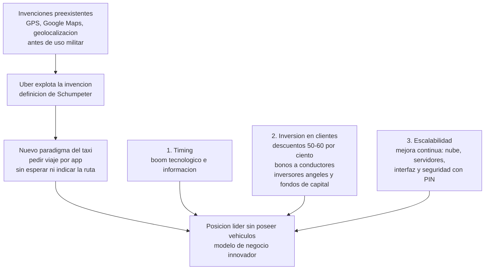

# Semana 1 — Fundamentos del emprendimiento: conceptos, origen, tipos y ecosistema

## Síntesis ejecutiva

La semana 1 inaugura la asignatura presentando al equipo docente y construyendo las bases conceptuales del emprendimiento: su origen histórico (francés *entrepreneur*, 1700), tres definiciones académicas complementarias (Schumpeter 1934, Timmons 1997, Alford, Brown y Letts 2004), su papel actual como motor económico y generador de empleo, los actores del ecosistema (universidades, empresas, gobiernos, sociedad civil) y los tipos de emprendimiento. El caso de Uber ilustra la definición de Schumpeter —explotar invenciones existentes para cambiar un paradigma— y los tres factores que explican el éxito de plataformas como Uber, Airbnb y Spotify: timing tecnológico, inversión agresiva en conquistar clientes (con años de pérdidas) y escalabilidad con mejora continua. La sesión advierte sobre la "romantización del emprendimiento" en Ecuador, donde predomina el emprendimiento por necesidad, y pide a cada estudiante construir su propia definición. Según las diapositivas, el cierre plantea que "emprender es una actitud" al alcance de todas las carreras.

## Ideas esenciales

### 1. El emprendimiento es un concepto plural y multidisciplinario
- **Idea:** No existe una sola definición: el emprendimiento puede verse desde la sociología, la economía, la ingeniería o la tecnología. Por eso, un objetivo declarado de la sesión es que cada estudiante construya su propia definición. Los otros dos objetivos expuestos: comprender conceptos básicos, origen, evolución y tipos; y reconocer la importancia de la innovación y la sostenibilidad.
- **Por qué importa:** La definición que se adopte determina qué se considera "emprender" y qué habilidades conviene desarrollar.
- **Relaciones:** Enmarca las tres definiciones académicas (idea 2), la definición personal del docente (idea 4) y la evolución del término (idea 3).
- **Ejemplo o evidencia:** Definiciones de estudiantes en clase: crear y promocionar un producto (Laura, 3.º semestre de Contabilidad); "lanzarse al ruedo" y arriesgarse saliendo de la teoría (Leonidas); materializar una idea organizándose, p. ej. una mermelada (Alba); crear un negocio a partir de una idea (Katiuska); la importancia del equipo de apoyo (Marco).

### 2. Tres definiciones académicas complementarias
- **Idea:**
  - *Schumpeter (1934):* el emprendimiento "genera nuevas combinaciones de recursos mediante la explotación de invenciones", produciendo un producto innovador vendible en el mercado. Rompe el *status quo* y la zona de confort de las empresas.
  - *Timmons (1997):* "forma de pensar, razonar y actuar obsesionada con la oportunidad, con enfoque holístico y liderazgo equilibrado". Implica algo sistemático y escalable, conectado con el contexto y las partes internas/externas del negocio; el fin es pasar del emprendimiento a la constitución de una empresa, no quedarse con 3–4 trabajadores.
  - *Alford, Brown y Letts (2004):* proceso que "crea soluciones innovadoras a los problemas sociales inmediatos y moviliza ideas, capacidades, recursos y acuerdos sociales para una transformación social sostenible". Base del emprendimiento social.
- **Por qué importa:** Ofrecen tres lentes: económico-innovador, de oportunidad-gestión y social-transformador.
- **Relaciones:** Schumpeter se ilustra con Uber (idea 11); Timmons enfatiza la oportunidad (clave en idea 10); Alford et al. anticipan el triple impacto (ver Notas, contenido de diapositivas).

### 3. Origen y evolución del término
- **Idea:** Proviene del francés *entrepreneur* (1700): "emprender una aventura/viaje". La definición moderna evolucionó de la simple creación de empresas hacia la innovación, la gestión de la incertidumbre y la generación de valor (económico, social o ambiental) mediante la identificación de oportunidades. Algunos autores añaden un cuarto impacto: el tecnológico.
- **Por qué importa:** Muestra que el concepto madura; hoy la tecnología es central.
- **Relaciones:** Conecta con la pluralidad conceptual (idea 1) y justifica el énfasis de la semana en innovación y sostenibilidad.

### 4. Definición propia del docente: talento + pasión + visión
- **Idea:** "El emprendimiento es la fusión de talento, pasión y visión, donde se transforma una idea innovadora en un negocio sostenible". Implica conectar campos diferentes para descubrir nichos, resolver problemas insatisfechos y generar valor con ingenio en todas las fases del negocio. Conviene emprender en lo que apasiona (si el rubro no gusta, se abandonará) y el emprendimiento "debe causar más felicidad"; el talento —habilidades y conocimiento técnico acumulado en escuela, universidad, maestría o posgrado— lleva el negocio más lejos.
- **Por qué importa:** Síntesis operativa que integra las definiciones académicas con la experiencia. El docente Andrés compartió que tuvo dos emprendimientos que no funcionaron como esperaba: emprender es experimentar y equivocarse.
- **Relaciones:** Se vincula con las herramientas (idea 5) y con la sostenibilidad (diapositivas).

### 5. Riesgo sí, pero con herramientas y red de apoyo
- **Idea:** Lo que distingue a un emprendedor es la disposición a asumir riesgos ("lanzarse al vacío"), pero ese salto exige herramientas adecuadas para atravesar momentos difíciles y buenos. Aunque en Ecuador el emprendimiento se vive como "proceso de soledad", el emprendedor casi nunca está solo: conectar con quienes apoyan (familia, amigos, equipo) es clave para desarrollar el producto o servicio y escalar.
- **Por qué importa:** Contrarresta la imagen romántica del emprendedor solitario y arriesgado.
- **Relaciones:** Conecta con Timmons (liderazgo equilibrado, equipos) y con el ecosistema (idea 9).

### 6. El contexto define cómo se emprende y de dónde vienen las oportunidades
- **Idea:** No es lo mismo emprender en Ecuador que en Australia: el escenario cambia y con él la forma de innovar. Entender el contexto local (necesidades sociales, proveedores, factores limitantes) permite generar productos o servicios innovadores para los usuarios.
- **Por qué importa:** Orienta el análisis hacia oportunidades reales del entorno, tema de la pregunta de cierre de la semana.
- **Ejemplo o evidencia:** El docente usó el incendio reciente en Quito como provocación (¿existiría un producto innovador que ayude a apagar incendios?); un estudiante señaló la falta de empleo como problema del entorno.

### 7. Romantización del emprendimiento y el "valle de la muerte"
- **Idea:** En Ecuador se ha "romantizado" emprender (prensa, radio, universidad): eso dinamiza el ecosistema, pero distorsiona la percepción de dificultad —"ponerle flores a un camino complejo". Emprender exige habilidades blandas, duras y conocimiento técnico para superar el famoso "valle de la muerte" de los primeros 3–5 años. Muchos emprenden por necesidad (desempleo, sostener la familia). El docente recomienda el estudio INDEM (UTPL) para conocer ese mapa y lo compartirá en sesiones posteriores; sugirió resumirlo con ayuda de IA (pasaje con transcripción dudosa).
- **Por qué importa:** Prepara expectativas realistas y explica el predominio del emprendimiento por necesidad.
- **Relaciones:** Ideas 5 (herramientas), 8 (empleo) y 10 (tipos por motivación).

### 8. ¿Por qué hablar de emprendimiento hoy?
- **Idea:** Porque es motor del crecimiento económico, generador de empleo y alternativa frente al desempleo, la pobreza y las desigualdades. Los países no pueden quedarse estáticos mientras el mundo compite; en Ecuador, la crisis de desempleo hace del emprendimiento una salida, a veces por pura necesidad o "hambre" de salir adelante (factor sociológico que el docente deja abierto a debate).
- **Por qué importa:** Justifica la relevancia pública y académica de la asignatura.
- **Relaciones:** Los actores del ecosistema (idea 9) existen justamente para potenciar estos efectos.

### 9. El ecosistema: cuatro actores y financiamiento local
- **Idea:** El emprendimiento se impulsa desde: (a) **Universidades** — asignaturas, incubadoras (Prendho en la UTPL), transferencia tecnológica en el Parque Científico y Tecnológico; (b) **Empresas** — *intraemprendimiento*: subempresas, nuevos productos o diversificación de cartera mediante pequeños grupos internos que generan valor; (c) **Gobiernos** — municipios, prefecturas y ministerios con programas, capacitaciones y secretarías de desarrollo económico que fortalecen el "tejido emprendedor"; (d) **Sociedad civil y ONGs** — fomentan el emprendimiento en localidades lejanas y generan la "presión sana" que empuja políticas, programas y fondos; sin participación ciudadana, el impacto no llega.
- **Ejemplo o evidencia:** EDEC en Cuenca (entidad de la alcaldía que asesora emprendedores); en Loja, Universidad, municipio y prefectura articulados con la incubadora; en Zamora, cooperativas que otorgan créditos pequeños (~$500–1,000 para maquinaria o insumos, montos que la banca tradicional no atiende, pues un emprendedor no pide $80,000–100,000), ferias de emprendedores del gobierno provincial y capacitaciones de entidades financieras.
- **Relaciones:** Antes de emprender conviene conocer estos actores locales; son los que ayudan a superar el valle de la muerte (idea 7).

### 10. Tipos de emprendimiento
- **Idea:** Clasificación general: **por motivación** — *oportunidad* (detectar un problema/necesidad y crear una solución) vs. *necesidad* (emprender para sobrevivir); en Ecuador predominan los de necesidad y se busca revertirlo con formación: localizar, identificar e investigar el problema antes de emprender. **Por tamaño** — de 2–3 personas hasta equipos de 5–15 colaboradores. **Por nivel de innovación** — emprendimiento de bases científico-tecnológicas, vinculado a universidades e investigación (la explicación quedó truncada en el transcript; las diapositivas mencionan los "ciclos EDCT" y transformar un proyecto, p. ej. un sistema de riego, en investigación y tesis). **Por tipo de emprendedor** — anunciado pero no desarrollado.
- **Por qué importa:** "No todos los emprendimientos son iguales ni persiguen los mismos fines" (diapositivas); la motivación condiciona enfoque y riesgo.
- **Relaciones:** La motivación conecta con la romantización (idea 7) y con el contexto (idea 6).

### 11. Factores de éxito de las plataformas digitales (caso Uber, Airbnb, Spotify)
- **Idea:** Ante la pregunta de si su éxito se debe a la automatización, el docente responde con tres factores: (1) **timing**: llegaron en el boom tecnológico, en el momento y lugar correctos, con información sobre hacia dónde iban los servicios; (2) **invertir para dar a conocer el producto**: años en pérdidas, sostenidas por inversores ángeles y fondos de capital; Uber ofrecía descuentos de 50–60% y bonos a conductores (50–80 carreras o ~5 horas seguidas) para generar conocimiento y confianza; (3) **escalabilidad**: mejora continua (espacio en la nube, servidores, interfaz) para mantenerse a la vanguardia; en el último año Uber priorizó la seguridad con el PIN/candado de 4 dígitos antes de abordar.
- **Por qué importa:** Descompone el "éxito instantáneo" en decisiones replicables y muestra que el crecimiento temprano se financia con pérdidas deliberadas.
- **Ejemplo o evidencia:** Uber explotó la geolocalización (antes de uso militar) para cambiar el paradigma del taxi —calle, espera de 10–15 minutos, indicar la ruta al conductor— y llegó a ser líder sin poseer vehículos. Un estudiante añadió que Uber da seguridad a conductor y pasajero, y que si el pasajero cancela, el conductor igual cobra.
- **Relaciones:** Aplica la definición de Schumpeter (idea 2); se profundiza en la sección de aplicación.

## Mapa conceptual

```mermaid
flowchart TD
    EMP["EMPRENDIMIENTO<br>concepto multidisciplinario<br>economia, sociologia,<br>ingenieria y tecnologia"]
    EMP --> ORIG["Origen<br>entrepreneur frances 1700<br>emprender una aventura"]
    EMP --> DEF["Definiciones academicas"]
    EMP --> PROP["Definicion propia<br>talento + pasion + vision<br>= negocio sostenible"]
    EMP --> HOY["Por que hoy"]
    EMP --> ECO["Ecosistema de actores"]
    EMP --> TIPOS["Tipos de emprendimiento"]

    DEF --> D1["Schumpeter 1934<br>nuevas combinaciones de recursos<br>explotando invenciones"]
    DEF --> D2["Timmons 1997<br>obsesion con la oportunidad<br>enfoque holistico y liderazgo"]
    DEF --> D3["Alford, Brown y Letts 2004<br>soluciones a problemas sociales<br>transformacion sostenible"]

    HOY --> H1["Motor de crecimiento economico"]
    HOY --> H2["Generador de empleo"]
    HOY --> H3["Alternativa frente al<br>desempleo y la pobreza"]

    ECO --> E1["Universidades<br>incubadoras y parque cientifico"]
    ECO --> E2["Empresas<br>intraemprendimiento"]
    ECO --> E3["Gobiernos<br>municipios, prefecturas, ministerios"]
    ECO --> E4["Sociedad civil y ONGs<br>presion y politicas"]

    TIPOS --> T1["Por motivacion<br>oportunidad vs necesidad"]
    TIPOS --> T2["Por tamano<br>de 2-3 a 5-15 personas"]
    TIPOS --> T3["Por nivel de innovacion<br>bases cientifico-tecnologicas"]
```

**Cómo leerlo:** El nodo central reúne las cinco dimensiones tratadas en la sesión: origen, definiciones académicas, definición propia del docente, justificación de su relevancia actual, ecosistema y tipologías. Las ramas inferiores muestran los componentes de cada dimensión; nótese que las tres definiciones académicas alimentan tanto la definición propia como el caso Uber del segundo diagrama.

**Cómo leerlo:** Se lee de arriba hacia abajo como causa-efecto: Uber parte de invenciones que ya existían, las explota (Schumpeter) y cambia el paradigma del taxi. Los tres factores convergen en la posición de liderazgo sin poseer vehículos; son la respuesta dada en clase a por qué estas plataformas triunfaron.

## Notas y puntos clave

- **Citas para memorizar:** Schumpeter (explotación de invenciones → producto innovador vendible); Timmons (obsesión por la oportunidad, enfoque holístico, liderazgo equilibrado); Alford, Brown y Letts (soluciones a problemas sociales → transformación social sostenible).
- **Distinción central:** emprendimiento por *oportunidad* (parte de un problema identificado e investigado) vs. por *necesidad* (parte de la falta de ingresos); en Ecuador predomina el segundo según los datos citados.
- **Intraemprendimiento:** emprender dentro de una empresa: subempresa, nueva línea o módulo, diversificación de cartera; pequeños grupos internos que generan mayor valor interno.
- **Valle de la muerte:** etapa crítica de los primeros 3–5 años; se atraviesa con habilidades blandas, duras y conocimiento técnico.
- **Romantización del emprendimiento:** glorificación mediática que dinamiza el ecosistema pero oculta la complejidad real del proceso.
- **Riesgo con herramientas:** asumir riesgos distingue al emprendedor, pero el "salto al vacío" exige herramientas; nadie emprende del todo solo.
- **Cuarto impacto:** además del triple impacto (económico, social, ambiental), algunos autores añaden el tecnológico.
- **Financiamiento local:** las cooperativas cubren microcréditos (~$500–1,000) que la banca tradicional no atiende, y suman capacitación a socios.
- **Incubadoras:** Prendho (UTPL); análoga en Cuenca: EDEC; para Quito quedó pendiente identificar entidades públicas (nota de diapositivas).
- **Estudio INDEM (UTPL):** fuente de datos sobre el emprendimiento en Ecuador; se trabajará en sesiones posteriores.
- **Administrativo:** Andrea Quezada, tutora de paralelos 190–194 (consultas por mensajería del EVA/correo); Jaime Rodríguez, tutor del 195 (posiblemente también 196–197); Andrés Tinajero, docente de clases; foro a responder esta semana/inicio de la siguiente (domingo, según diapositivas); se envió un formulario para elegir la empresa que se analizará como caso; el paralelo reúne a ~190 estudiantes (diapositivas).
- **Solo en diapositivas** (no desarrollado en la parte disponible del transcript): *emprendimiento sostenible* — triple impacto económico, social y ambiental; autores Hart & Milstein (1999), Schaltegger et al. (2018), Muñoz & Cohen (2017); ejemplo Chocolates Pacari: precio justo al pequeño productor (social), rentabiliza el cacao (económico), recupera y monetiza un producto propio del Ecuador fomentando su consumo y producción (ambiental); la nota advierte "investigar más". *GEM:* el estudio más prestigioso y extenso sobre emprendimiento; +100 países desde 1999; fundado por Babson College y London Business School; coordinado por la Global Entrepreneurship Research Association. *GEM Ecuador 2025 / OTEA Ecuador 2024:* cifra de 33,37% (significado no verificable por el desorden de la diapositiva), líder regional con alta concentración en consumo (81,26%); IA: 28,53% la considera muy importante hoy y 32,95% la proyecta como clave en 3 años. *Cierre:* "emprender es una actitud; no depende solo del dinero; la innovación y la sostenibilidad son claves; todas las carreras pueden emprender".

## Aplicación: Uber y Airbnb

**Lo que plantea el documento de referencia:**
- Pregunta clave: ¿cómo Uber y Airbnb alcanzaron su gran posición y automatizaron su modelo de negocio, monetizando enormemente bienes de los que no son propietarios?
- Estrategia enumerada: (1) invertir en ganar clientes; (2) componente tecnológico: obtener y explotar información; invertir fuerte en marketing incluso con pérdidas; crear familiarización con los clientes; invertir en tecnología, mantenimiento y actualizaciones; implementar mejoras continuas —seguridad con PIN de tarjeta; nube, servidores, interfaz—.
- Antecedentes: inversores ángeles; descuentos iniciales de Uber (50%, 30%) para generar confianza; extras a conductores por más de 80 carreras o 5 horas seguidas.

**Lo que aporta el transcript:**
- Uber como caso de Schumpeter: explotó una invención existente (GPS/Google Maps; geolocalización de uso previamente militar) para cambiar el paradigma del taxi y volverse líder sin vehículos mediante modelos de negocio innovadores.
- Los tres factores de éxito (timing e información; inversión con pérdidas sostenidas por inversores ángeles y fondos de capital; escalabilidad con mejora continua y seguridad PIN) — detalle en la idea 11.
- Aporte estudiantil: Uber brinda seguridad a ambas partes y compensa al conductor ante cancelaciones.
- Airbnb solo se nombra junto a Uber y Spotify como plataforma que llegó "en el momento correcto"; no se analiza en detalle.
- El caso se profundizará en sesiones futuras (formulario para elegir empresa).

**Conexiones e inferencias (marcadas como tales):**
- *(Inferencia)* Los pasos del documento se corresponden con los factores del transcript: "invertir en ganar clientes" y "marketing con pérdidas" = factor 2; "obtener y explotar información" = factor 1; "tecnología, mejoras continuas y seguridad" = factor 3.
- *(Inferencia)* La parte de la pregunta sobre monetizar bienes sin ser propietarios solo se responde parcialmente (la mención de líder sin poseer vehículos); el mecanismo completo del modelo *asset-light* no se desarrolla en las fuentes disponibles y queda como tema probable de próximas sesiones.
- *(Discrepancia menor)* Descuentos iniciales: transcript 50–60% vs. documento 50% y 30%; umbrales de bonos: transcript 50–80 carreras o ~5 horas vs. documento +80 carreras o +5 horas.

## Preguntas para profundizar

1. ¿Qué distingue un emprendimiento por oportunidad de uno por necesidad, y por qué predomina el segundo en Ecuador? ¿Cómo ayudaría la formación previa (localizar, identificar, investigar el problema) a invertir esa tendencia?
2. ¿Qué invención concreta explotó Uber según Schumpeter, y qué elementos del paradigma anterior del taxi eliminó o transformó?
3. ¿Por qué resultó racional para Uber regalar descuentos y sostener años de pérdidas? ¿Qué papel cumplen inversores ángeles y fondos de capital en esa etapa?
4. ¿Qué riesgos tiene la romantización del emprendimiento para quien emprende por necesidad, y cómo se relaciona con el "valle de la muerte"?
5. Comparando las tres definiciones académicas, ¿cuál describe mejor a Uber y cuál se ajustaría más a un caso como Pacari (diapositivas)? ¿Por qué?
6. ¿Qué actores del ecosistema operan en tu ciudad y cuál consultarías primero si emprendieras (incubadora, cooperativa, secretaría, universidad)? ¿Qué te aportaría cada uno?
7. Según el documento de Uber y Airbnb, ¿por qué "invertir bastante en marketing, incluso si involucra pérdidas" puede ser una decisión estratégica y no un error?
8. ¿Cómo se complementan talento, pasión y visión en la definición del docente? ¿Qué le pasaría a un negocio si falta uno de los tres elementos?

## Glosario

- **Emprendimiento:** creación de valor mediante identificación de oportunidades, innovación y gestión de la incertidumbre; sin definición única (ideas 1–3).
- **Entrepreneur:** término francés (1700), origen de "emprendimiento"; "emprender una aventura".
- **Intraemprendimiento (interemprendimiento):** emprendimiento interno en una empresa: subempresas, nuevos productos o diversificación de cartera con grupos internos.
- **Emprendimiento por oportunidad:** surge de detectar un problema o necesidad insatisfecha y crear una solución.
- **Emprendimiento por necesidad:** surge de la falta de empleo o ingresos; se emprende para sobrevivir. Predominante en Ecuador según la sesión.
- **Emprendimiento de bases científico-tecnológicas:** tipo por nivel de innovación, vinculado a universidades e investigación (explicación incompleta en las fuentes).
- **Inversor ángel:** inversor individual que financia etapas tempranas asumiendo pérdidas iniciales.
- **Fondo de capital:** vehículo de inversión que financia el crecimiento temprano de plataformas absorbiendo pérdidas.
- **Valle de la muerte:** etapa crítica de los primeros 3–5 años del emprendimiento.
- **Romantización del emprendimiento:** glorificación mediática que oculta la complejidad real del proceso.
- **Mejora continua:** actualizaciones sucesivas (nube, servidores, interfaz, seguridad) para mantenerse a la vanguardia.
- **Escalabilidad:** capacidad de crecer en clientes y operaciones una vez que el mercado conoce y se familiariza con el producto.
- **Ecosistema de emprendimiento:** conjunto de actores (universidades, empresas, gobiernos, sociedad civil y ONGs) que fomentan el emprendimiento en un territorio.
- **Incubadora:** entidad que apoya emprendimientos en etapas iniciales (Prendho en la UTPL; EDEC en Cuenca).
- **Triple impacto:** beneficios económicos, sociales y ambientales; algunos añaden un cuarto impacto tecnológico.
- **GEM (Global Entrepreneurship Monitor):** estudio global más extenso sobre emprendimiento; +100 países desde 1999 (solo en diapositivas).
- **Geolocalización:** tecnología de ubicación, antes de uso militar; base de la invención explotada por Uber.
- **INDEM:** estudio sobre el emprendimiento en Ecuador realizado por la UTPL.

## Cobertura y límites

- El transcript se corta mientras se explica el emprendimiento de bases científico-tecnológicas; la clasificación "por tipo de emprendedor" no se desarrolló (tampoco en las diapositivas). El transcript, además, comienza a mitad de una conversación (comentarios de retroalimentación sin contenido sustantivo) y termina truncado.
- Emprendimiento sostenible, GEM, GEM Ecuador 2025 y el cierre final constan solo en las diapositivas; no están desarrollados en la parte disponible del transcript. Las cifras del bloque GEM Ecuador/OTEA están desordenadas y el significado exacto de 33,37% no puede verificarse.
- Transcripciones dudosas reconstruidas con cautela: "estudio Indem" (probablemente INDEM), nombre de la incubadora ("frentwood"/"prejuod" en audio vs. "Prendho" en diapositivas), herramienta de IA mencionada ("Claudia Copaylot", posiblemente Claude/Copilot) y "cooperativas de oro y crédito" en Zamora.
- Airbnb no se analiza específicamente en el transcript; el mecanismo de monetización "sin ser propietarios de bienes" queda sin desarrollar en las fuentes.
- Discrepancias menores transcript vs. documento Uber: porcentajes de descuento y umbrales de bonos (ver sección de aplicación).

## Control de calidad

- **Cobertura:** todas las secciones sustantivas disponibles del transcript (equipo docente, definiciones, discusión con estudiantes, caso Uber, ecosistema, tipos) están representadas; el contenido exclusivo de diapositivas está marcado como tal.
- **Organización:** ideas agrupadas en 11 secciones; el caso Uber se detalla una vez y se referencia en la aplicación, sin repetición innecesaria.
- **Trazabilidad:** cada afirmación proviene del transcript, de las diapositivas o del documento Uber/Airbnb; las inferencias están identificadas.
- **Diagramas:** sintaxis Mermaid validada (etiquetas entre comillas, saltos con ` `), con guía de lectura tras cada uno.
- **Condensación:** el documento permite estudiar la semana sin releer el transcript; los vacíos quedan señalados en "Cobertura y límites".