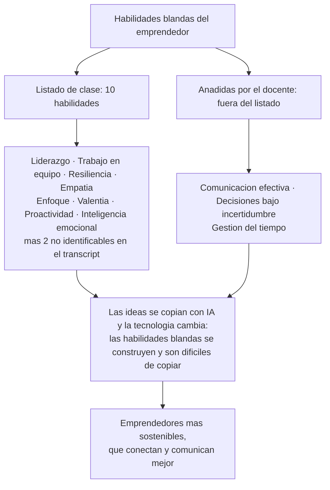
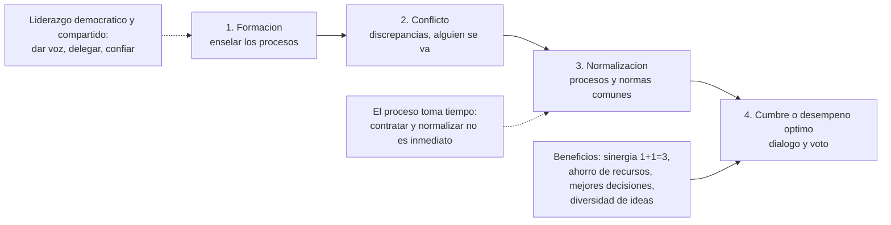
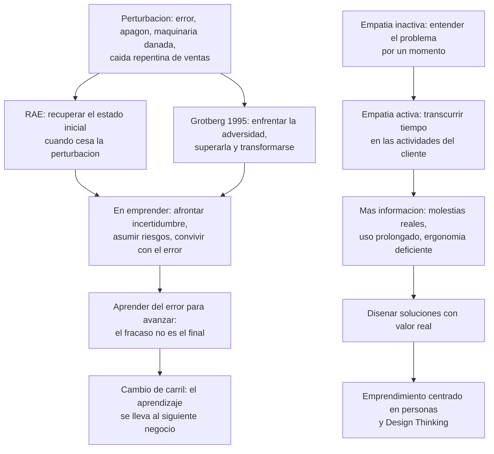

# Semana 2 — Habilidades blandas del emprendedor

## Síntesis

La sesión aborda las habilidades blandas aplicadas al emprendedor, a partir de un listado de 10 habilidades (de las cuales el transcript permite identificar con certeza 8: liderazgo, trabajo en equipo, resiliencia, empatía, enfoque, valentía, proactividad e inteligencia emocional). Tras una actividad en la que los estudiantes eligen la habilidad más importante, el docente profundiza en cuatro de ellas: **liderazgo** (evolución de autoridad a agente de cambio, con ética, honestidad, credibilidad, autoconocimiento y liderazgo compartido), **trabajo en equipo** (beneficios, etapas de conformación y el miedo a asociarse en Ecuador), **resiliencia** (definiciones de la RAE y de Grotberg 1995; aprender del error para avanzar) y **empatía** (crítica a la empatía inactiva frente a la empatía activa como base del emprendimiento centrado en personas y del Design Thinking). El cierre argumenta que las ideas y las tecnologías se copian, pero las habilidades blandas no: son lo que hace sostenible a un emprendedor. Una pregunta final abre el tema de las políticas públicas de emprendimiento en Ecuador.

## Estado de las fuentes

- El transcript es un archivo de subtítulos que **comienza a mitad de la clase** (ya se estaba explicando liderazgo y enfoque) y contiene líneas duplicadas y errores de transcripción. Se deduplicaron los fragmentos repetidos.
- Errores de transcripción relevantes, normalizados en este documento: *"residencia"* → **resiliencia**; *"grodberg"* → atribución a **Grotberg** (1995, grafía según las notas preliminares; el transcript no permite confirmar la escritura); *"designting"* → **Design Thinking**.
- La parte inicial de la clase —donde probablemente se presentó el tema y el listado completo de 10 habilidades— **no está disponible**. Dos habilidades del listado no pueden identificarse.

## Estado de las notas preliminares

| Nota preliminar                                              | Estado                                                       |
| ------------------------------------------------------------ | ------------------------------------------------------------ |
| RAE: resiliencia = capacidad de un material, mecanismo o sistema para recuperar su estado inicial cuando cesa la perturbación | **Confirmada en el transcript** (casi textual)               |
| Grotberg (1995): capacidad de enfrentar la adversidad, superarla y transformarse | **Confirmada** (transcrito como "grodberg"; grafía no confirmable desde el transcript) |
| Resiliencia ↔ afrontar la incertidumbre, asumir riesgos y convivir con el error | **Confirmada**                                               |
| "El fracaso no es el final: forma parte del proceso de aprendizaje" | **Confirmada** (frase textual del docente)                   |
| Definición de habilidades blandas (capacidades personales, sociales y emocionales que permiten liderar, resolver conflictos, adaptarse, comunicar) | **No verificada en el transcript** — la definición formal no aparece; compatible con el desarrollo de la clase |
| Diferencia duras (conocimientos técnicos) vs. blandas (comportamiento, actitud, inteligencia emocional) | **No verificada en el transcript** — no se enuncia como distinción formal; parcialmente compatible con fragmentos (conocimiento técnico vs. habilidades blandas difíciles de copiar) |
| "El emprendimiento exige conocimiento técnico y habilidades humanas" | **No verificada textualmente**; coherente con la historia personal del docente y con el cierre de la sesión |

## Ideas esenciales

### 1. Las habilidades blandas son la ventaja que no se copia
- **Idea central:** Las ideas hoy se copian —con IA, dos personas en países distintos obtienen las mismas 5 ideas ante el mismo prompt (ejemplo: "dame 5 ideas de postres a partir de la mora que hay en Ecuador" vs. alguien en Chile)— y las tecnologías cambian. Lo difícil de copiar son las habilidades blandas, porque se construyen.
- **Explicación:** El emprendedor que desarrolla habilidades blandas es más sostenible, conecta mejor y comunica mejor.
- **Importancia o aplicación:** Justifica que toda la asignatura dedique una sesión completa a este tema y la actividad de autoevaluación final.
- **Relación con otros conceptos:** Contra el "error clásico" de centrarse solo en el producto (idea 7); enlaza con la Semana 1: el talento técnico (definición del docente) no basta sin las habilidades humanas *(conexión entre semanas)*.

### 2. Liderazgo emprendedor: innato o adquirido, en evolución
- **Idea central:** El liderazgo puede ser innato (niños que lideraban a sus amigos y familias) o adquirido (formado en el tiempo, p. ej., gustándole hablar en público). Evoluciona **de autoridad a gerente a agente de cambio**, y hoy se pasa del liderazgo **autoritario** al **democrático**: "esta es la fórmula del producto, pero si ustedes ven opciones de mejora, coméntenlas" — se da voz al equipo.
- **Importancia o aplicación:** Un estudiante (Henry) lo eligió como la habilidad más importante: el fundador no debe ser solo jefe, sino líder que hace que el emprendimiento ocurra como lo concibe. El docente añade: no solo liderar yo, sino generar liderazgos internos en la empresa.
- **Relación con otros conceptos:** "El liderazgo actual y el trabajo en equipo van muy de la mano" (idea 3); el liderazgo democrático desemboca en el liderazgo compartido (idea 4).
- **Nota:** el transcript abre a mitad de esta explicación; el inicio de la exposición se perdió.

### 3. Características del líder emprendedor
- **Idea central:** Ética ("no puedo decir que soy buen líder si en mis negocios se hacen cosas ilícitas"), honestidad con trabajadores, socios, proveedores y clientes (ejemplo: decir que un chocolate adelgaza cuando tiene más azúcar que otros es deshonesto y no ético — es preferir vender antes que entregar un buen producto), credibilidad (ser en verdad confiable), autoconocimiento (reconocer los propios valores y principios) y **liderazgo compartido** (atribuido a **Arbaiza, 2019**): dos personas en la gerencia, un consejo directivo, un equipo que decide a medida que crece; saber delegar y confiar.
- **Importancia o aplicación:** El emprendedor **lidera personas, ideas y procesos incluso sin un cargo formal**: en un equipo de 5, uno lidera a los otros 4 sin rol definido; el emprendedor es multifacético y empieza con el equipo que tiene, no con uno grande.
- **Relación con otros conceptos:** El liderazgo compartido es la forma madura del liderazgo democrático *(inferencia a partir de la secuencia de la clase)*.

### 4. Trabajo en equipo: beneficios, etapas y tiempo
- **Idea central:** Beneficios: **sinergia** ("1+1=3" en términos empresariales: dos personas multiplican y elevan el conocimiento), ahorro de recursos, mejores decisiones (alguien con otra visión resuelve lo que parecía inviable por costos) y diversidad de ideas (el equipo desbloquea el proceso creativo estancado).
- **Explicación — etapas de conformación** (sin autor citado en el transcript): **1) Formación** (enseñar los procesos) → **2) Conflicto** (discrepancias; de 3 personas se quedan 2 y hay que contratar de nuevo porque alguien no se acopló) → **3) Normalización** (procesos y normas comunes: "las mismas recetas" en la panadería) → **4) Cumbre o desempeño óptimo** (diálogo, voto). El proceso **toma tiempo**: contratar 3 personas para una panadería y esperar que al día siguiente todo funcione no es realista.
- **Importancia o aplicación:** Johana lo eligió como la habilidad más importante: sin equipo se pierden oportunidades, y el emprendimiento se valida por las oportunidades que aprovecha.
- **Relación con otros conceptos:** La empatía también se aplica al equipo (entender a quien se siente mal o no rinde) (idea 7).

### 5. El contexto ecuatoriano: miedo a asociarse
- **Idea central:** En Ecuador hay miedo y recelo a asociarse; una mala experiencia pasada hace pensar que "siempre va a pasar", y los emprendimientos pierden oportunidades por no trabajar en equipo. En Loja hay muchos emprendimientos de café pero pocos asociados; no hay marcas fusionadas.
- **Ejemplo mencionado en clase:** Tres emprendimientos cafeteros: el primero tiene 3 máquinas para secar café (una traída de Italia, otra de EE. UU., otra ensamblada localmente); el segundo tiene otras 3 de secado; ninguno tiene la máquina especial de molienda en cantidad que exige un cliente internacional — la tiene un tercer emprendimiento que solo muele (sin finca, sin producción, sin secado). Por recelo a compartir información, ninguno se une y **pierden al cliente**.
- **Relación con otros conceptos:** Ilustra el costo de omitir las etapas del trabajo en equipo (idea 4) *(inferencia)*; conecta con la idea de la Semana 1 de que "el emprendedor nunca está solo" *(conexión entre semanas)*.

### 6. Resiliencia: aprender del error para avanzar
- **Idea central:** No es "ya resistí y paso a otra cosa". Dos definiciones: **RAE** — capacidad de un material, mecanismo o sistema para recuperar su estado inicial cuando ha cesado la perturbación (concepto de ingeniería de materiales); **Grotberg (1995)** — capacidad de enfrentar la adversidad, superarla y transformarse (enfoque psicológico). Aplicada al emprendimiento: **afrontar la incertidumbre, asumir riesgos y convivir con el error**.
- **Explicación:** La "perturbación" puede ser un error o algo no planeado (apagones, maquinaria dañada). Igual que el metal vuelve a su estado inicial tras la fuerza, el emprendedor sometido a un cambio externo o interno fuera de su control puede continuar y volver a su estado **una vez que ha aprendido**. En Ecuador muchas incertidumbres (los apagones) no se pueden maniobrar: lo que sí se puede es asumir el riesgo, buscar soluciones y no cerrar el negocio.
- **Frase y analogía:** "El fracaso no es el final, es parte del proceso de aprendizaje". Analogía del bache: ir a 80 km/h y caer en un bache — los estudiantes responden "se daña el neumático, los amortiguadores"; el docente propone otro enfoque: el bache hace **saltar el auto a otra autopista**. Si las ventas caen repentinamente (a ~100 dólares — pasaje ambiguo en la transcripción), uno puede quedarse con el negocio dañado o tomar "el otro carril": el salto conlleva el aprendizaje hacia el siguiente negocio, entendiendo dónde estuvo el error.
- **Ejemplo mencionado en clase:** Historia personal del docente: el emprendimiento que más le gustó **quebró** porque su conocimiento financiero era "el 10% de lo que es hoy" y el equipo tampoco sabía lo que desarrollaba. Aprendizaje: desarrollar producto es importante, pero **gestionar también**; hay que formar **equipos multidisciplinares** (no 5 doctores emprendiendo juntos, sino doctores + contabilidad + administración + marketing). Que fracasaran por tener todos los mismos conocimientos es parte de lo que la resiliencia convierte en learning para el siguiente negocio.

### 7. Empatía activa: de "ponerse en los zapatos" a vivir la realidad
- **Idea central:** La frase clásica "ponte en los zapatos del cliente" lleva a una **empatía inactiva**: entender el problema por un momento ("me dolió ponerme el zapato"). La **empatía activa** es transcurrir un periodo de tiempo en las actividades del otro: usar el zapato incómodo todo el día produce "ampollas, dolor de piernas y de espalda" — mucha más información. Definiciones: RAE — capacidad de identificarse con alguien y compartir sus sentimientos; enfoque emprendedor — ponerse en el lugar de otro **y buscar resolver sus problemas**.
- **Importancia o aplicación:** Es "fundamental al momento de emprender" porque lo primero es **entender al cliente**. Evita dos **errores clásicos**: (1) "este producto me gusta tanto a mí que a todos les va a gustar" y (2) "yo hago esto superbien, entonces me van a comprar" — emprendimientos que no escalan, con las mismas ventas mes a mes: pagan cuentas, pero el negocio no crece. No se trata de tachar el camino recorrido: si el emprendimiento actual genera recursos, se sigue; pero para un producto nuevo, primero empatía. También sirve dentro del equipo (comprender a quien se siente mal).
- **Ejemplo mencionado en clase:** Producto con suela incómoda: la empatía inactiva solo agregaría una plantilla; la activa detecta material que hace transpirar, pie que se calienta, diseño ergonómico deficiente → **diseñar otro producto**.
- **Relación con otros conceptos:** Del entendimiento del cliente se diseñan soluciones con valor real: es la **base del emprendimiento centrado en las personas**, que usa **Design Thinking** — metodología que se revisará para el **portafolio emprendedor de la próxima semana**. Ernesto añadió que la empatía permite recibir conocimiento de otros, trabajar en equipo y "avanzar hacia la inteligencia emocional".

### 8. Otras habilidades del listado (identificables en el transcript)
- **Enfoque:** saber el momento correcto y dónde poner la atención (desarrollo de producto, marketing, ventas, optimización de procesos). Ejemplo: encadenar degustaciones infinitas sin decidir el lanzamiento — tampoco se puede decidir sin probar: el extremo contrario es lanzar sin validar. Sin enfoque se pierde tiempo y no se avanza hacia el producto definitivo.
- **Valentía:** desde el enfoque de **asunción de riesgos**; saber cuándo tomar la decisión, dar el paso al frente, atreverse a exportar o a desarrollar un nuevo producto. Una estudiante por chat la eligió como la más importante.
- **Proactividad:** no puede decirse "tengo mi producto y con este paso 10–20 años": el entorno es cambiante, ágil, volátil, digital y tecnológico. Lo que uno genera, alguien lo genera en otro lado del mundo (p. ej., Singapur) y, por e-commerce y logística optimizada, puede llegar a Ecuador **en un mes** y "destruir totalmente el mercado". Sin proactividad no se investiga ni se sigue desarrollando.
- **Inteligencia emocional:** controlar las emociones; habrá días buenos (comprarse un auto con los ingresos) y sumamente malos (vender ese auto). Sin regulación se deciden sesgos emocionales; el emprendedor necesita pensamiento crítico y analítico al decidir, y tomar con calma tanto lo bueno como lo malo.
- **Liderazgo que genera líderes:** dar paso a otros para que generen liderazgos internos.
- *(Observación estructural, inferencia del orden de la clase: las cuatro profundizaciones —liderazgo, trabajo en equipo, resiliencia, empatía— coinciden con las habilidades que los estudiantes eligieron como más importantes.)*

### 9. Habilidades complementarias fuera del listado (aporte del docente)
- **Comunicación efectiva:** "súper relevante hoy"; transmitir la visión y la claridad del mensaje de la **propuesta de valor** — qué se va a vender.
- **Toma de decisiones bajo incertidumbre:** decidir basándose en la información y los datos almacenados.
- **Gestión del tiempo:** viene del ámbito académico (aprender, hacer tareas, múltiples actividades); llevada al emprendimiento, es **organizar y priorizar procesos** de la operación diaria del negocio.

## Desarrollo de los temas

1. **Continuación del listado de habilidades.** El transcript abre a mitad de la explicación de liderazgo y enfoque; se presentan luego empatía, valentía, proactividad, inteligencia emocional, trabajo en equipo y resiliencia. El docente aclara que son "estas 10 habilidades" (lámina/documento que enviará; dos no identificables en el transcript).
2. **Actividad: "¿cuál es la más importante?".** Respuestas: Johana — trabajo en equipo; Henry — liderazgo; Sadán — resiliencia (días buenos y malos; concentrarse solo en las bajas lleva al pesimismo y al abandono); Bryan — resiliencia (adaptarse a situaciones difíciles; muchos se rinden aun con conocimiento teórico previo, sin saber cuántos intentos harán falta; pilar también en lo laboral y personal); Ernesto — empatía (todas están vinculadas; la empatía habilita el resto); por chat — resiliencia y valentía. José Luis no pudo intervenir (micrófono apagado).
3. **Habilidades faltantes.** El docente añade comunicación efectiva, toma de decisiones bajo incertidumbre y gestión del tiempo (idea 9).
4. **Liderazgo.** Innato/adquirido → evolución autoridad–gerente–agente de cambio → tipos autoritario/democrático → características: ética, honestidad, credibilidad, autoconocimiento, liderazgo compartido (Arbaiza, 2019) → el emprendedor lidera sin cargo formal.
5. **Trabajo en equipo.** Beneficios (sinergia 1+1=3, ahorro, mejores decisiones, diversidad) → etapas formación–conflicto–normalización–cumbre → toma tiempo → ejemplo de la panadería → contexto ecuatoriano y ejemplo de los tres emprendimientos de café.
6. **Resiliencia.** Definición RAE (materiales) → traslado al emprendimiento (perturbaciones: errores, apagones, maquinaria) → definición psicológica (Grotberg 1995) → afrontar incertidumbre, asumir riesgos, convivir con el error → frase del fracaso → analogía del bache → historia personal del emprendimiento que quebró.
7. **Empatía.** Crítica a la frase de los zapatos → empatía inactiva vs. activa → errores clásicos del emprendedor → diseño de soluciones con valor → base del emprendimiento centrado en personas y Design Thinking (portafolio, próxima semana).
8. **Cierre pedagógico.** Actividad opcional con dos preguntas: (1) ¿qué habilidad debo fortalecer más? (2) ¿cómo impactará en mi futuro con un emprendimiento o en mi aspecto profesional? El docente compartió su caso: su habilidad deficiente era el liderazgo ("no me gustaba liderar, me gustaba crear y hacer que las cosas pasen"); la fortaleció durante años para hablar en público, sentirse confiado y proyectar sus ideas. Remate: las ideas se copian (IA), las tecnologías cambian; las habilidades blandas se construyen y diferencian.
9. **Pregunta de Ernesto — políticas públicas.** ¿El emprendimiento en Ecuador frente a otros países respecto de políticas estatales? Respuesta (punto de vista personal del docente): la falta de políticas públicas dificulta los emprendimientos. Ley de emprendimiento trabajada en la Asamblea pero poco revisada; ordenanzas aisladas (Quito: fomento al emprendimiento; Guayaquil: emprendimiento e innovación; Ambato: jóvenes y emprendimiento, en desarrollo; Cuenca: algo similar); fondos públicos de apoyo **solo en Quito**; el financiamiento es una brecha central — sin crédito a interés bajo, el mejor emprendedor queda "atado de manos". Problema de la patente: el municipio trata al emprendimiento como a una multinacional (en Quito pasó a un valor único, ~10 dólares, monto no confirmado por el propio docente). Recomendación: desde cualquier carrera (derecho, psicología, ingeniería…), **exigir** a las entidades espacios, capacitación, apoyo económico y políticas; en el ecosistema, el actor más importante es el emprendedor (la sociedad civil): si nadie pide, no se consigue. Adelanto: para la próxima clase enviará un artículo que mapea **5 brechas del emprendimiento en Ecuador** (estudio de un profesor), para leer y comentar.
10. **Cierre administrativo.** Nueva viñeta "Equipo docente" en la plataforma (enlace directo al Zoom de conducción, martes 20:00, paralelo C11). Tutores: 190–194 Andrea; 195–196 Jaime; 197 Boris (posiblemente Boris Galarza; paralelos restantes por confirmar). Próxima sesión: martes siguiente, 20:00; se pidió encender cámaras para futuras sesiones.

## Mapa conceptual

**Cómo leerlo:** El nodo superior divide las habilidades tratadas en dos grupos: el listado de clase (con la advertencia de que dos escapan al transcript) y las tres que el docente añadió. La cadena inferior condensa el argumento de cierre: las habilidades blandas son la ventaja no copiable que produce emprendedores más sostenibles.

**Cómo leerlo:** El flujo principal (izquierda a derecha) son las cuatro etapas de conformación de un equipo descritas en clase. Las flechas punteadas indican factores que acompañan el proceso: los beneficios que se obtienen al llegar al desempeño óptimo, el tipo de liderazgo que lo habilita desde la formación, y la advertencia de que todo requiere tiempo.

**Cómo leerlo:** Dos cadenas independientes. La de la resiliencia (arriba): una perturbación activa dos definiciones —la técnica de la RAE y la psicológica de Grotberg— que convergen en la aplicación emprendedora y desembocan en la analogía del "cambio de carril". La de la empatía (abajo): se progresa de la empatía inactiva a la activa, que genera información para diseñar valor y conecta con Design Thinking, tema de la siguiente semana.

## Notas y puntos clave

- **Frases para recordar:** "El fracaso no es el final, es parte del proceso de aprendizaje" · "1+1=3" (sinergia) · "Si te pones en los zapatos del cliente, te van a doler los pies: no son tu medida" · "El emprendedor lidera personas, ideas y procesos, incluso sin un cargo formal".
- **Definiciones con atribución:** Resiliencia — RAE (recuperar el estado inicial tras la perturbación; origen en ingeniería de materiales) y Grotberg 1995 (transcript: "grodberg"; enfrentar, superar y transformarse). Empatía — RAE (identificarse y compartir sentimientos); emprendedora (ponerse en el lugar del otro y buscar resolver sus problemas, permaneciendo en sus actividades). Liderazgo compartido — Arbaiza (2019). Las etapas del trabajo en equipo se presentaron sin autor citado.
- **Errores clásicos del emprendedor (empatía):** creer que "si a mí me gusta, a todos les gustará" y "si lo hago superbien, me comprarán" → ventas planas, sin escalabilidad.
- **Regla práctica:** equipos multidisciplinares (la experiencia del docente: falló un equipo con conocimientos homogéneos y sin gestión financiera).
- **Empatía activa vs. inactiva:** la inactiva entiende el problema un momento; la activa "vive" el problema un día completo y produce información de diseño.
- **Enfoque:** dos extremos a evitar — probar/degustar indefinidamente sin decidir, o decidir sin validar.
- **Proactividad y globalización:** un competidor en Singapur puede llegar vía e-commerce en un mes; hay que investigar y seguir desarrollando.
- **Contexto ecuatoriano:** predominio del miedo a asociarse; los apagones como ejemplo de incertidumbre incontrolable; financiamiento y patente como quejas concretas.
- **Tareas y anuncios:** actividad opcional de autoevaluación (habilidad a fortalecer + impacto futuro) con documento que se enviará; artículo sobre las 5 brechas del emprendimiento en Ecuador para la próxima clase; revisar la viñeta "Equipo docente" en la plataforma; foro/tutores según paralelo.
- **Conexión con la Semana 1** *(inferencia marcada)*: la resiliencia y la gestión de la incertidumbre operan como respuesta al "valle de la muerte"; la advertencia de la Semana 1 ("el salto al vacío exige herramientas") se concreta aquí en habilidades blandas como herramientas.

## Preguntas para profundizar

1. ¿Por qué el docente sostiene que las ideas y las tecnologías se copian mientras las habilidades blandas no? ¿Qué implica esto para la competencia entre emprendimientos?
2. Contrasta la empatía inactiva y la activa con el ejemplo del zapato: ¿qué información adicional produce la empatía activa y cómo cambia la decisión de diseño del producto?
3. Según las etapas del trabajo en equipo, ¿qué pasa si un emprendedor contrata y reemplaza personal sin pasar por la normalización? ¿Qué muestra el ejemplo de la panadería?
4. En el ejemplo de los tres emprendimientos de café, ¿qué asociación les habría permitido atender al cliente internacional y qué barreras culturales lo impidieron?
5. ¿Qué diferencia hay entre "resistir" y "aprender del error para avanzar"? Relaciónala con la definición de la RAE aplicada a los negocios.
6. En la analogía del bache, ¿qué representa el "otro carril" y qué se lleva el emprendedor al siguiente negocio?
7. ¿Cómo se relacionan el liderazgo democrático, el liderazgo compartido de Arbaiza (2019) y la idea de "generar liderazgos internos" en la empresa?
8. ¿Por qué la falta de fondos públicos y de políticas deja al emprendedor "atado de manos", y qué papel asigna el docente a la sociedad civil (los propios emprendedores) para cambiarlo?
9. *(Actividad de la clase)* ¿Qué habilidad de las tratadas necesitas fortalecer más y cómo impactaría en tu futuro profesional o en un futuro emprendimiento?

## Glosario

- **Habilidades blandas:** en las notas preliminares, capacidades personales, sociales y emocionales (liderar, resolver conflictos, adaptarse, comunicar). **No definidas formalmente en el transcript disponible**; en clase se trabajan como las capacidades no técnicas, difíciles de copiar, que se construyen con el tiempo.
- **Habilidades duras:** conocimientos técnicos (contenidos en las notas preliminares; **no verificada** la distinción formal en el transcript).
- **Liderazgo innato/adquirido:** capacidad de liderar con la que se nace o que se forma con el tiempo.
- **Liderazgo autoritario vs. democrático:** imponer decisiones ("no se hable más") vs. dar voz al equipo y aceptar mejoras.
- **Agente de cambio:** etapa final de la evolución del liderazgo (autoridad → gerente → agente de cambio).
- **Liderazgo compartido (Arbaiza, 2019):** varios responsables gerenciales, consejo directivo o equipo decisor a medida que crece el emprendimiento; delegar y confiar.
- **Sinergia:** "1+1=3": el trabajo conjunto multiplica el conocimiento.
- **Etapas del trabajo en equipo:** formación, conflicto, normalización y cumbre (desempeño óptimo); sin autor citado en el transcript.
- **Resiliencia (RAE):** capacidad de recuperar el estado inicial cuando cesa la perturbación (concepto aplicado desde la ingeniería de materiales). **(Grotberg, 1995):** enfrentar la adversidad, superarla y transformarse.
- **Empatía inactiva / activa:** entender el problema por un momento vs. transcurrir tiempo en las actividades del otro para obtener información real.
- **Propuesta de valor:** aquello que se va a vender; su claridad es objeto de la comunicación efectiva.
- **Design Thinking:** metodología de emprendimiento centrado en las personas; base del portafolio emprendedor (próxima semana).
- **Toma de decisiones bajo incertidumbre:** decidir con base en la información y datos disponibles cuando no hay certeza.
- **Gestión del tiempo:** organizar y priorizar procesos de la operación diaria del negocio (trasladada del ámbito académico).
- **Ordenanza / fondos públicos / patente:** instrumentos del ecosistema público de emprendimiento citados en la pregunta final (normas municipales, financiamiento estatal, tasa municipal).

## Capturas pendientes

[PLACEHOLDER: insertar captura del documento/lámina con las 10 habilidades blandas. Ubicación o descripción disponible en el transcript: «Les hago una pregunta a partir de estas 10 habilidades» (~20:35) y «les voy a enviar este documento» (~21:01). Aspectos que conviene revisar en la captura: la lista completa de las 10 habilidades —dos no aparecen en el transcript— y si cada una incluye definición o gráfico.]

[PLACEHOLDER: insertar captura de la lámina sobre evolución y tipos de liderazgo. Ubicación o descripción disponible en el transcript: «vamos de una evolución de liderazgo desde autoridad a gerente a agente de cambio… ahí tipos de liderazgo» (~20:42–20:47). Aspectos que conviene revisar: si la evolución y los tipos aparecen como esquema visual y si se listan características adicionales del líder.]

[PLACEHOLDER: insertar captura de la lámina de trabajo en equipo. Ubicación o descripción disponible en el transcript: «me pasé a la siguiente lámina» (~20:46), antes de los beneficios y etapas del trabajo en equipo. Aspectos que conviene revisar: el listado exacto de beneficios y de las cuatro etapas tal como fueron presentadas.]

## Control de calidad

- **Cobertura:** se cubrió todo el contenido sustantivo disponible: habilidades del listado, actividad de votación, habilidades añadidas, las cuatro profundizaciones (liderazgo, equipo, resiliencia, empatía), actividad de cierre, pregunta sobre políticas públicas y cierre administrativo. Las líneas duplicadas del archivo de subtítulos fueron deduplicadas.
- **Notas preliminares:** confirmadas o marcadas **no verificadas en el transcript** en la tabla específica; ninguna se presenta como contenido de la clase sin confirmación.
- **Inferencias identificadas:** la correspondencia entre profundizaciones y respuestas de los estudiantes, las conexiones entre liderazgo democrático y compartido, y los vínculos con la Semana 1 están marcados como inferencia o conexión.
- **Sin datos externos:** no se añadieron autores, modelos ni cifras externos (p. ej., no se atribuyen las etapas del equipo a ningún autor no citado; los montos y nombres se mantienen con su incertidumbre declarada).
- **Diagramas:** tres diagramas Mermaid con sintaxis validada (etiquetas entre comillas, sin paréntesis) y guía de lectura.
- **Limitaciones declaradas:** el transcript inicia a mitad de clase; dos habilidades del listado son irrecuperables; pasajes ambiguos (ventas "al 100"/100 dólares; "realmente es un trabajo individual", donde el contexto sugiere que faltó una negación) se señalaron en vez de reconstruirse.