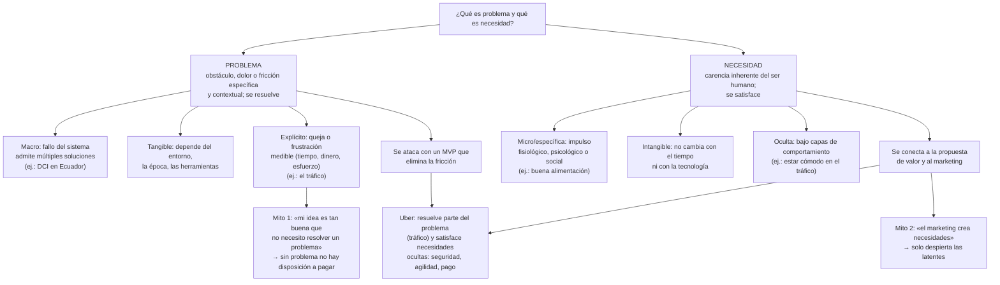
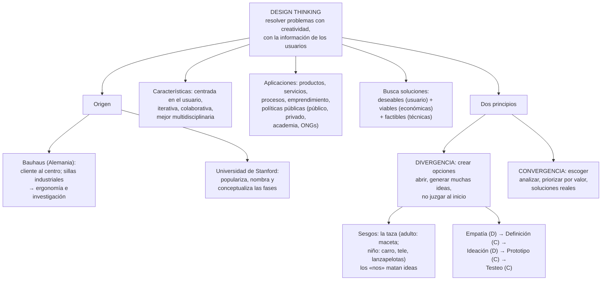
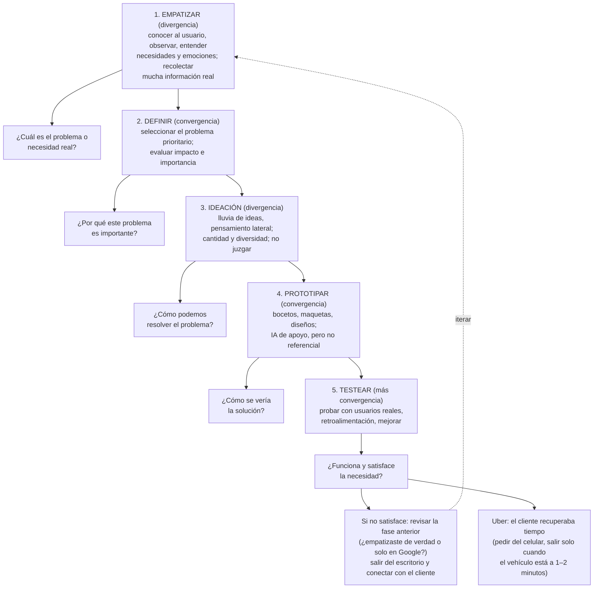
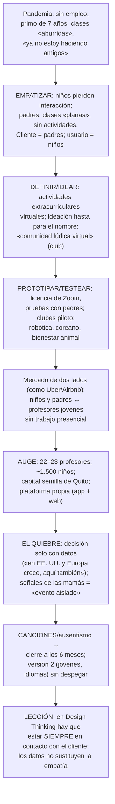

# Semana 4 — Design Thinking: del problema y la necesidad a la generación de ideas

> **Convención de fuentes:** esta semana solo se dispone del transcript de la sesión sincrónica (semana 4, martes 27 de octubre de 2026); no hay diapositivas ni documentos de referencia subidos. Todo el contenido proviene del transcript (incluidas las intervenciones de estudiantes); se marca **[I]** las inferencias o conexiones propias. Las ambigüedades se detallan en la sección final del documento.

## Síntesis ejecutiva

La semana 4 abre formalmente la unidad 2 («Empatizando con el entorno y generación de ideas») con dos objetivos: comprender el **Design Thinking** —la metodología que usarán para el portafolio emprendedor— y aprender a **identificar problemas reales y generar ideas innovadoras de negocio**, con las personas en el centro de los procesos de desarrollo. La sesión se articuló en tres bloques. Primero, la distinción conceptual entre **problema** (obstáculo, dolor o fricción específica y contextual que impide alcanzar un objetivo; macro, tangible, expresado como queja, «se resuelve») y **necesidad** (carencia inherente del ser humano; micro, intangible, oculta bajo capas de comportamiento, «se satisface»), con dos mitos derribados: «mi idea es tan buena que no necesito resolver un problema real» (falso: sin problema no hay disposición a pagar) y «el marketing crea necesidades» (falso: solo despierta necesidades latentes). Segundo, la metodología Design Thinking: su origen en la escuela **Bauhaus** (cliente al centro) y su popularización en **Stanford**, sus características (centrada en el usuario, iterativa, colaborativa y multidisciplinaria), sus dos principios (**divergencia** para crear opciones y **convergencia** para escoger) y sus **cinco fases** (empatizar, definir, idear, prototipar y testear), cada una con su pregunta clave, ilustradas con Uber (que resuelve parcialmente el tráfico pero satisface necesidades ocultas: seguridad, agilidad, rapidez de pago) y con el caso personal del docente, la app **«Club Academy»** (comunidad lúdica virtual), que muestra tanto el ciclo completo de la metodología como el costo de dejar de escuchar al cliente. Se cerró con la aplicación del Design Thinking en el sector público (contratación por innovación, retos de la Unión Europea, Agenda 2030/ODS) y las instrucciones del portafolio: la parte 1 (empatizar y definir) ya está publicada y la idea debe encajar en uno de los tres desafíos («Vivir con IA», «Vivir mejor», «Vivir con menos impacto»).

## Ideas esenciales

### 1. Problema vs. necesidad: dos conceptos que no deben confundirse
- **Idea:** La sesión parte de dos preguntas: ¿qué es un problema y qué es una necesidad? El docente las sistematiza así:

| Dimensión            | **Problema**                                                 | **Necesidad**                                                |
| -------------------- | ------------------------------------------------------------ | ------------------------------------------------------------ |
| Definición           | Obstáculo, dolor o **fricción** específica y contextual que impide a un usuario alcanzar un objetivo o realizar una tarea | Estado de **carencia inherente** del ser humano (fisiológico, psicológico o social); un impulso fundamental |
| Alcance              | **Macro**: fallo del sistema; admite múltiples soluciones (producto, servicio, proyecto) | **Micro/específica**: del ser humano; da pie a productos o servicios concretos |
| Naturaleza           | Más **tangible**: depende del entorno, la época, las herramientas disponibles | Más **intangible**: no cambia con el tiempo ni con la tecnología (superación, salir adelante, más conocimiento) |
| Verbalización        | El cliente la expresa como queja explícita o frustración **medible** (pérdida de tiempo, dinero, esfuerzo) | Rara vez se verbaliza de forma directa; suele estar **oculta bajo varias capas de comportamiento** |
| Verbo                | Se **resuelve**                                              | Se **satisface**                                             |
| Analogía del docente | «La fricción»                                                | «El motor»                                                   |

- **Por qué importa:** Emprender puede partir de cualquiera de las dos, pero lo mejor es encontrar el problema, recolectar información y hablar con el cliente (empatizar, como en la clase anterior) para descubrir las necesidades ocultas: el problema macro se ve, la necesidad hay que excavarla.
- **Relaciones:** Enlaza con la semana 3 (empatía como herramienta para descubrir necesidades ocultas) y fundamenta las fases 1–2 del Design Thinking (idea 8).
- **Ejemplo o evidencia:** Respuestas de los estudiantes: problema = «algo que se puede solucionar»; necesidad = «algo que se puede adquirir» (primer estudiante); Ernesto: la necesidad como «estado de carencia» de alguna dimensión (supervivencia, salud, alimentación, desarrollo intelectual) que «no permite avanzar»; Alexa: problema = obstáculo o situación no favorable; necesidad = algo que se requiere o se busca. Síntesis del docente: la **desnutrición crónica infantil (DCI)** en Ecuador es un problema; la buena alimentación de estudiantes y jóvenes es una necesidad; el tráfico en Quito, Guayaquil y Cuenca es un problema; «estar cómodo mientras manejo» es una necesidad (sentado una hora en el tráfico: un relajante muscular, un hidratante si hace calor, un saco si hace frío o llueve, información de rutas).

### 2. Resolver el problema, satisfacer la necesidad: el caso Uber
- **Idea:** El **problema se resuelve** generando un **producto mínimo viable (MVP)** con características específicas para eliminar la fricción. Pero hay que preguntarse siempre: **¿en qué medida se resuelve?** Uber resolvió *parcialmente* el problema del tráfico con su sistema de movilidad (pedir un vehículo de punto A a punto B sin salir a la calle); no lo resuelve totalmente —si hay muchos Uber, taxis y vehículos, el tráfico sigue igual; da «un porcentaje de solución»—. Lo que más hace Uber es **satisfacer**: usa la necesidad para conectar con un mensaje de marketing, una propuesta de valor y las actividades del cliente. Las necesidades ocultas que encontró y satisface: **seguridad, agilidad y rapidez en el pago**.
- **Por qué importa:** Distingue dos logros distintos: eliminar fricción (problema) y conectar emocionalmente con el usuario (necesidad); una propuesta de valor vive sobre todo en el segundo plano.
- **Relaciones:** Retoma el caso Uber de las semanas 1 y 3 con una lente nueva (ya no el origen del negocio, sino la relación problema-necesidad); alimenta el ejemplo de testeo (idea 9).
- **Ejemplo o evidencia:** Formulación de la clase: *problema*: «me toma 45 minutos encontrar un taxi seguro en la calle cuando llueve y a veces me cobran tarifas arbitrarias»; *necesidades*: sentirse seguro, optimizar el tiempo y tener **previsibilidad financiera** (saber cuánto se pagará de un punto A a un punto B).

### 3. Dos mitos a derribar
- **Idea:** (1) *«Mi idea es tan buena que no necesito resolver un problema real»* — totalmente falso: **sin problema no hay disposición a pagar**; un producto «tan bueno que cualquier familia del Ecuador me va a consumir», pero que no resuelve nada, no genera pago: fue hecho sobre la *creencia* de un problema. (2) *«El marketing de mi empresa va a crear una nueva necesidad a la gente»* — falso: aunque se venda esa idea (neuromarketing y afines), **el marketing solo despierta necesidades que ya están latentes**; no las inventa.
- **Por qué importa:** Desarma las dos excusas típicas para no investigar al usuario; ancla el negocio en la realidad del cliente.
- **Relaciones:** Refuerza la idea 2 (Uber satisfizo necesidades que ya existían) y el mensaje de la semana 3 (la idea es para esa persona, no para uno mismo).
- **Ejemplo o evidencia:** La necesidad de seguridad en el taxi **ya existía**: al tomar un taxi amarillo no se sabía el nombre del conductor ni del auto, no se podía enviar información; el marketing solo posicionó como novedoso y diferenciador lo que la gente ya esperaba.

### 4. Conocer al usuario: de la idea brillante a la innovación
- **Idea:** Conocer realmente al usuario es medular. **La innovación no comienza con una idea brillante, sino con una comprensión profunda de las personas y su entorno.** Una idea brillante sin esa comprensión queda en **invento**. «Si tenemos muy buenas ideas y son brillantes, estamos generando inventos; y no queremos inventos, queremos generar negocios en esta asignatura.»
- **Por qué importa:** Reubica el esfuerzo del estudiante: menos genio creativo solitario, más investigación y contacto con personas.
- **Relaciones:** Recapitula la semana 3 (empatizar como cimiento) y el recordatorio de tipos de emprendimiento (semana 1): emprender desde la **oportunidad** (encontrar problema y necesidad), no desde la necesidad económica («necesito dar de comer a mi familia»).
- **Ejemplo o evidencia:** **Leonardo da Vinci**: sus dibujos y maquetas eran brillantes, pero quedaron en inventos «porque no se pudo profundizar en la comprensión de las personas y del entorno» — no se ve cómo esos bocetos iban a mejorar la calidad de vida de las personas. Respuestas de estudiantes: Brian (conocer al usuario permite conocer su necesidad o problema), Jessica (resolver la necesidad hace que el negocio funcione mejor), Lady (ejemplo del local de ropa: si el cliente pide talla XL/2XL y no la tienes, esa es su necesidad; traerla lo satisface; también outfit en tendencia), Ernesto (chat): «es medular, es el centro del avance para el éxito, es estratégico para innovar o mejorar el servicio o producto; con todo eso se llega a soluciones modelos».

### 5. Design Thinking: qué es y de dónde nace
- **Idea:** Metodología centrada en el desarrollo a partir de la **información que dan los usuarios o las personas**, para **resolver problemas mediante creatividad**. Origen: aunque hoy en Internet se dice que nació en la **Universidad de Stanford** —cierto en cuanto a la aplicación metodológica—, comenzó su desarrollo en la antigua escuela de diseño **Bauhaus** (Alemania), con un enfoque de diseño centrado en el cliente y en la forma de pensar de los diseñadores. Antes, la Bauhaus y toda la revolución industrial generaban **productos industriales** sin enfoque real en el cliente (materia prima disponible → hacer sillas que resistan). Esta escuela empezó a poner **al cliente en el centro del desarrollo** mediante investigación, empatía y descubrimiento de necesidades, e incorporó aspectos técnicos (si el cliente decía que la silla era incómoda, se revisaban temas **ergonómicos** y se mejoraba el producto). Después la metodología dio el salto a las universidades: Stanford la popularizó, le dio **nombre** y **conceptualizó las fases**; desde ahí tomó popularidad mundial. [Dato del docente vía Ernesto: la Bauhaus nació como escuela de arquitectura, pasó a arquitectura y diseño, y tuvo hibridaciones; el método se aplicó a productos, arquitectura y artes.]
- **Por qué importa:** Entender el origen explica el principio rector de la metodología (el usuario al centro) y previene el mito de que es una moda de Stanford.
- **Relaciones:** Fundamenta las características (idea 6) y conecta con la Bauhaus como antecedente del diseño centrado en el usuario de la semana 3.
- **Ejemplo o evidencia:** Los taburetes metálicos escolares de la época industrial: espalda a 90 grados, asiento «como una regla», diseñados para resistencia y rendimiento, no para la persona («después de dos horas en esas sillas ya acababas sin espalda»).

### 6. Características, aplicaciones y el trío deseable–viable–factible
- **Idea:** Características principales: **centrada en el usuario**; **iterativa** (si algo sale mal en una fase, se puede volver a la anterior, descubrir el error y rehacer el proceso); **colaborativa** (no trabaja un solo diseñador: equipos, mejor aún si son **multidisciplinarios** — p. ej., para el problema de la DCI convocar a estudiantes de medicina, ingeniería, administración, derecho y educación: visión distinta, mayor diversidad de ideas en la ideación, mejor producto). Se aplica al desarrollo de **productos, servicios y procesos**, y al **campo del emprendimiento** (tanto para sacar un nuevo producto en un emprendimiento en marcha como para averiguar necesidades, plantear el problema y desarrollar la solución innovadora). El Design Thinking ayuda a crear **soluciones deseables, viables y factibles**: deseables (para el cliente), viables (con **viabilidad más que todo económica**), factibles (técnicamente realizables — el audio es poco claro en este punto; ver Ambigüedades).
- **Por qué importa:** Son los criterios con los que se evaluará el portafolio emprendedor y cualquier aplicación real de la metodología.
- **Relaciones:** La multidisciplina conecta con la reflexión de la semana 3 (mentores de pares, equipos diversos) y con el cierre de esta sesión (buscar una contraparte de otra disciplina).
- **Ejemplo o evidencia:** El docente confirma, a partir del aporte de Ernesto sobre contratación pública, que la metodología también se aplica en **políticas públicas y desarrollo público**, y que hoy la usan **sector público, privado, academia y ONGs**, casi siempre con adaptaciones según el público (ver idea 11).

### 7. Divergencia y convergencia: los dos principios
- **Idea:** **Divergencia = crear opciones**: abrir posibilidades, generar muchas ideas, pensar fuera de la caja, **no juzgar al inicio** (el lado creativo e «intrépido»). **Convergencia = escoger**: el lado analítico, seleccionar, **priorizar ideas con mayor valor**, enfocarse en soluciones reales. La secuencia de fases alterna ambos modos: empatía (divergencia), definición (convergencia), ideación (divergencia), prototipo (convergencia) y testeo (aún más convergencia): hay que ser **creativos en empatía e ideación** y **analíticos en definición, prototipado y testeo**. Advertencia: según estudios de psicólogos, el pensamiento divergente se dificulta con la edad porque acumulamos **sesgos** y «nos» («esto no es posible»); hay que trabajar la parte creativa.
- **Por qué importa:** Indica en qué momento de la metodología se abre y en cuál se cierra; confundir el momento lleva a matar ideas valiosas o a elegir sin criterio.
- **Relaciones:** La prohibición de juzgar en la ideación retoma el «no pasar por el 'creo, me parece, tal vez'» de la semana 3, ahora en clave creativa; prepara la lectura de las cinco fases (idea 8).
- **Ejemplo o evidencia:** El ejercicio de la **taza**: a un adulto con muchos sesgos, «¿qué puede ser una taza?» → recipiente de esferos, maceta, portapelotitas (ideas obvias); a un niño con menos sesgos → un carro, una tele, un lanzapelotas… Derivaciones actuales (doble diamante, escuelas de diseño, circular): «al final las fases no han cambiado».

### 8. Las cinco fases y sus preguntas clave
- **Idea:** El ciclo del Design Thinking, fase por fase:
  1. **Empatizar** (divergencia): conocer al usuario, observar el entorno, entender necesidades, emociones y comportamientos. Pregunta clave: **¿cuál es el problema o necesidad real?** Recolectar la mayor cantidad de información posible (del cliente, de redes, de investigación y papers) sin ir hacia lo convencional.
  2. **Definir** (convergencia): seleccionar el **problema prioritario** y evaluar su impacto e importancia. Pregunta clave: **¿por qué este problema es importante?** En la industria real habría que considerar las capacidades técnicas, tecnológicas y económicas del negocio; para el portafolio (ejercicio académico), escoger una opción que resuelva un problema y permita desarrollar algo innovador — no descartar por «esto es muy caro» sin analizar.
  3. **Ideación** (divergencia): con el problema claro, generar la mayor **cantidad y diversidad** de ideas creativas mediante lluvias de ideas, pensamiento lateral y herramientas por venir. Pregunta clave: **¿cómo podemos resolver el problema?** No hay nada imposible: no juzgar, porque cada «esto no es posible» pierde una idea valiosa.
  4. **Prototipar** (convergencia): convertir la idea en algo tangible: bocetos, maquetas, modelos, diseños básicos. Hoy se usa IA y plataformas (válido), pero los prototipos **no siempre fueron tecnológicos** (antes: un dibujo, una maqueta, un render), y la imagen que genera la IA muchas veces **no es referencial** a lo que realmente se va a construir. Pregunta clave: **¿cómo se vería la solución?** En la industria real se trabaja con la unidad de desarrollo/productiva y la normativa: de la idea al prototipo **muchas veces hay cambios**.
  5. **Testear** (aún más convergencia): probar con usuarios reales, recibir retroalimentación y mejorar la solución. Pregunta clave: **¿funciona y satisface la necesidad?**
- **Por qué importa:** Es el esqueleto del portafolio emprendedor (su primera entrega cubre fases 1 y 2) y el mapa que ordena las próximas semanas del curso.
- **Relaciones:** La fase 1 es la semana 3 aplicada; la fase 4 retoma la advertencia sobre «soluciones avanzadas» de la semana 3; la fase 5 cierra el ciclo (idea 9).
- **Ejemplo o evidencia:** La **moto casi acuática**: idea «súper loca» de una moto que, con las lluvias fuertes del Ecuador, aprieta un botón y se convierte casi en un jet ski; al pasar al desarrollo real, por temas técnicos no es del todo posible, pero sí engranajes o procesos para que la moto **se impermeabilice** cuando llueva y no se dañe — la idea se transforma al prototipar.

### 9. Testear e iterar: ¿funciona y satisface la necesidad?
- **Idea:** El testeo **cierra el ciclo de desarrollo con una evaluación**: comprobar que la solución genera satisfacción sobre la necesidad y el problema detectados en la empatía. Si el cliente dice «esto no me satisface, esto no funciona», hay que **revisar en cuál fase anterior hubo una falla** — típicamente en empatizar: si toda la información se recolectó por Internet, leyendo o «poniendo en Google», no hay información real. **Hay que salir del escritorio y conectar con el cliente.** Si no: se desarrolla algo que no satisface la necesidad y **el cliente no paga** («si no me da más tiempo, más comodidad, más salud, diré: no es necesario pagar, voy a seguir usando lo que uso actualmente»).
- **Por qué importa:** Convierte la metodología en un circuito de mejora (iteratividad) y explica el fracaso comercial como falla de fase, no como mala suerte.
- **Relaciones:** Aplica la iteratividad de la idea 6; devuelve al inicio del ciclo (empatizar) y retoma el mensaje de la semana 3 (salir de la idea propia para entender a la persona).
- **Ejemplo o evidencia:** Uber en el testeo: el cliente decía **perder tiempo**; tras el proceso, el aplicativo y sus funciones hacen que el cliente **tenga más tiempo** — ya no esperabas 15 minutos en la calle alzando la mano: pedías del celular y salías solo cuando el vehículo estaba a 1–2 minutos, aprovechando mejor el tiempo (terminar un trabajo, conversar) en lugar de estar en la calle, al sol o en la lluvia.

### 10. Caso Club Academy: design thinking en la práctica — y el costo de dejar de escuchar al cliente
- **Idea:** El docente presenta como caso de uso su propio emprendimiento (uno de los que tuvo), una plataforma construida con Design Thinking durante la pandemia:
  - **Empatizar:** sin empleo (daba capacitación presencial), observó el escenario y encontró el problema en los niños: su primo de ~7,5 años le decía que las clases eran «aburridas» y que «ya no estaba haciendo amigos» — las capacidades de interacción se estaban perdiendo. Luego habló con padres de familia: las clases en línea eran «muy planas» (diapositivas «a lo loco», sin imágenes; igual que una clase universitaria), los niños ya no hacían actividades. Cliente = **madres y padres**; usuario = **niños**; ambos con problemas y necesidades similares.
  - **Definir e idear:** necesidades insatisfechas de **actividades extracurriculares** (como los clubes escolares de siempre: fútbol, ajedrez, gimnasia, básquet). La ideación se aplicó incluso al nombre: de «comunidad lúdica» a «club» — denominación final: **comunidad lúdica virtual**.
  - **Prototipar y testear:** pagó una licencia educativa de Zoom, hizo pruebas pequeñas e invitaciones a padres; surgieron clubes piloto mapeados hablando con clientes y niños (robótica, coreano, bienestar animal). Al ver que faltaban profesores, construyó un **mercado de dos lados** «más o menos como un Airbnb o un Uber»: niños y padres que querían actividades ↔ profesores jóvenes que se habían quedado sin trabajo presencial.
  - **Auge:** ~22–23 profesores; alrededor de **1.500–1.510 niños impactados**; 3 campamentos vacacionales [audio impreciso: «3 vacacionales»]; ganaron el **fondo de capital semilla de la ciudad de Quito** y desarrollaron plataforma propia (aplicativo + web).
  - **El quiebre:** se dejó de escuchar al cliente y se decidió por **investigación, información y datos**: como la industria edtech infantil crecía en Europa y EE. UU., «en Ecuador y Sudamérica debería pasar lo mismo… y eso es mentira; eso cambia mucho en el contexto y el entorno». Las mamás —quienes siempre tomaban la decisión— pedían lo presencial; una mamá (primera clienta) llamó por teléfono cuando la pandemia cedía: la niña salía con sus amigas y había más actividades fuera de casa. En el equipo, con el dashboard de datos, se concluyó que era un «evento aislado» (el cofundador, de perfil financiero, tomaba las decisiones en el tercer año). El docente sintió «esa chispa» de que algo no iba bien, pero no la entendió. Tres–cuatro meses después: cancelaciones de suscripciones, ausentismo de los niños, padres que no respondían mensajes, profesores que volvieron a lo presencial; **a los seis meses cerraron operaciones** («sin niños no sirve de nada la idea»). Reformularon una **versión 2** enfocada en jóvenes (idiomas, asesorías de tutores), recuperando 4 de los 22 profesores, pero «no logró alzar vuelo»: no había un mercado tan apegado a la educación virtual para niños y jóvenes.
  - **Lección:** dentro del uso de Design Thinking hay que **estar siempre en contacto con el cliente**; los datos complementan, no sustituyen, la empatía. **[I]**
- **Por qué importa:** Es la demostración end-to-end de la metodología por quien la aplicó, incluyendo el fracaso: muestra que la metodología no es lineal hacia el éxito y que abandonar la escucha rompe el ciclo.
- **Relaciones:** Encadena todas las ideas 5–9; el error de extrapolar datos de EE. UU./Europa conecta con la semana 1 (el contexto manda: no es lo mismo emprender en Ecuador que en Australia) y con la semana 3 (la idea es para esa persona).
- **Ejemplo o evidencia:** Frase del docente: «no escuchamos al cliente y nos guiamos mucho por investigación, información y datos… la lógica es: estamos utilizando ya de esta manera en Estados Unidos y en Europa, así mismo la van a utilizar, y eso es mentira».

### 11. Design Thinking en el sector público: retos, subvenciones e inversión vs. gasto
- **Idea:** A partir del aporte de Ernesto, la sesión extiende la metodología al ámbito público. Ernesto explicó que gobiernos y multinacionales practican la **contratación pública por tecnología e innovación**: se hace una consulta de mercado donde emprendedores presentan prototipos, y el pago se realiza **aunque el prototipo no sea óptimo** — el objetivo es iterar del prototipo a la solución como política de Estado (práctica habitual de la comunidad económica europea; si el prototipo funciona, una empresa puede tomar el proceso y masificarlo). El docente confirmó que el Design Thinking se usa en **políticas públicas y desarrollo público**, en sector público, privado, academia y ONGs, y que la Unión Europea **fondea proyectos desde el sector público**, enfocados sobre todo en **cambio climático y agricultura**, presentados como **retos** o convocatorias para **equipos multidisciplinarios** (p. ej., una comunidad en Italia: derecho, ingeniería, hidrología…). Ernesto añadió el marco de la **Agenda 2030 y los ODS**: los estados que innovan lo ven como **inversión, no gasto** («invertimos en mil propuestas y con una que dé la solución ya nos alimentamos; la inversión es recuperable»), mientras en América Latina se ve como gasto — la contraloría exige resultados inmediatos y tangibles — y faltan políticas públicas que apoyen el eje de innovación. El docente cerró: estas metodologías toman tiempo, «no es que de la noche a la mañana… a la primera que la utilizas tienes el eureka; muchas veces también es prueba y error», y eso no se ve como inversión sino como gasto.
- **Por qué importa:** Amplía el horizonte de aplicación de la metodología y conecta el emprendimiento con el ecosistema de financiamiento público (semana 1: los gobiernos como actores del ecosistema).
- **Relaciones:** Retoma el rol de los gobiernos (semana 1) y la multidisciplina de la idea 6; la crítica al «gasto» recuerda el paradigma que frena la innovación en la región.
- **Ejemplo o evidencia:** La lógica de inversión de Ernesto: «invertimos en mil propuestas y de las mil propuestas una que nos dé la solución…» frente a la contraloría que pregunta «¿por qué invirtieron en algo que no resultó?».

## Mapa conceptual

**Diagrama 1 — Problema vs. necesidad**

*Lectura:* el dilema inicial se abre en las dos columnas; cada una desciende por alcance, naturaleza y verbalización hasta su verbo (resolver/satisfacer); abajo convergen en Uber, que opera simultáneamente en ambas columnas, y en los dos mitos que el docente pide derribar.

**Diagrama 2 — Design Thinking: origen, características y principios**

*Lectura:* el bloque central define la metodología y de él cuelgan su historia (Bauhaus → Stanford), sus rasgos, sus ámbitos de aplicación y el trío de criterios; a la derecha, los dos principios con el ejercicio de la taza y la alternancia divergencia/convergencia a lo largo de las fases.

**Diagrama 3 — Las cinco fases: modo, acciones y pregunta clave**

*Lectura:* las cinco fases encadenadas con su modo (divergente/convergente) y su pregunta clave; el ciclo se cierra en el testeo y, si falla, la flecha punteada devuelve el proceso a empatizar: la metodología es iterativa, no lineal. Uber ilustra un testeo exitoso sobre la necesidad de tiempo.

**Diagrama 4 — Caso Club Academy: del auge al cierre**

*Lectura:* el caso recorre las cinco fases (empatizar → definir → idear → prototipar/testear) hasta el auge; el nodo «quiebre» marca el punto donde se abandonó la escucha del cliente; la caída y el cierre desembocan en la lección central de la sesión.

## Notas y puntos clave

- **Objetivos de la sesión:** comprender qué es el Design Thinking (principios, fases, desarrollo centrado en las personas) e identificar problemas reales para generar ideas innovadoras de negocio. Unidad 2: «Empatizando con el entorno y generación de ideas».
- **Portafolio emprendedor:** ya está publicado en **anuncios** (anuncio del 26 de octubre, 11:28; verificado en clase el 27) la **parte 1**: los **tres desafíos** en PDF anclados — **Desafío 1: «Vivir con IA»**, **Desafío 2: «Vivir mejor»**, **Desafío 3: «Vivir con menos impacto»** — y el **formato del portafolio**. El primer avance corresponde a las **fases 1 y 2 (empatizar y definir)**: selección del segmento de mercado, proceso de empatizar/investigación y entrevistas a personas del segmento. El **mapa de empatía** se verá la **próxima semana (5)**. Por ahora es **individual** (parejas aún sin confirmar; avisarán por anuncios). Todo lo trabajado se va **anclando al portafolio**: no hay pruebas ni evaluaciones sueltas; la nota va anclada a esta actividad y habrá una **presentación final**.
- **Regla de los desafíos:** la idea del portafolio debe **encajar en uno de los tres desafíos** (ejemplos discutidos en clase: un hidrocarburo de bajo impacto o un sistema para aprovechar el gas que se quema en las chimeneas podrían encajar en «Vivir mejor»; un «invento» de petróleo sin encaje, no).
- **Logística de evaluación sincrónica:** la **videocolaboración** se movió a la **semana 6**: **martes 10 de noviembre, 20:00** (por confirmar ajuste de fechas desde coordinación). El **bootcamp** (alternativa presencial que exime de la del martes): **sábado 14 de noviembre, 9:00–12:00**, en los **centros UTPL de Azogues, Loja, Manta, Tena y Quito** (esta ocasión no hay en Salinas ni Cuenca; las ciudades rotan por ciclo). Si ninguna opción es viable → **actividad suplementaria**. Llegará un **formulario de inscripción**. El bootcamp híbrido es difícil (requiere soporte tecnológico; se consultará con coordinación). En ambas modalidades hay que **participar**, no «asistir y quedarse quieto como estatua».
- **Fases en la práctica:** los prototipos **no siempre fueron tecnológicos** (dibujo, maqueta, render); usar IA y plataformas es válido, pero la imagen generada muchas veces **no es referencial** a lo que realmente se construirá.
- **Cierre de la sesión (resumen del docente):** el Design Thinking **conecta personas, problemas y creatividad** (personas = usuarios; problemas = los del entorno; creatividad = la de cada uno); **empatizar es la base de todo**; **la innovación es un proceso, no un momento** (se trabaja a diario); **el trabajo colaborativo potencia los resultados**: al aplicar la metodología, busquen siempre una **contraparte de otra disciplina** (derecho, turismo, medicina, contabilidad, administración…) que piense diferente.
- **Próxima semana (5):** el mapa de empatía. Revisar los anuncios del EVA; dudas por mensaje a los docentes de acompañamiento.

## Aplicación: los casos de la sesión — Uber y Club Academy

Esta semana no existe documento de referencia aparte (como el «Pregunta clave» de la semana 1): ambos casos provienen del transcript. Uber reaparece como ejemplo conceptual y Club Academy como demostración completa de la metodología por parte del docente.

**Uber como ilustración del marco problema–necesidad–testeo (según el transcript):**

| Concepto de la semana             | Aplicación en Uber                                           |
| --------------------------------- | ------------------------------------------------------------ |
| Problema (macro, explícito)       | El tráfico en Quito, Guayaquil y Cuenca; hallar un taxi seguro bajo la lluvia (45 minutos) con tarifas arbitrarias |
| Necesidades (ocultas, latentes)   | Sentirse seguro, optimizar el tiempo, **previsibilidad financiera** (saber cuánto se pagará de A a B); comodidad durante el trayecto |
| Resolver (MVP)                    | El sistema de movilidad (pedir del celular de punto A a B) resuelve **un porcentaje** del problema: con muchos Uber y taxis, el tráfico sigue igual |
| Satisfacer (propuesta de valor)   | Conecta con necesidades latentes —seguridad (conocer conductor y auto, compartir información), agilidad, rapidez en el pago— vía mensaje de marketing |
| Testeo («¿funciona y satisface?») | El cliente decía perder tiempo; con la app lo recupera: salir solo cuando el vehículo está a 1–2 minutos, en vez de esperar 15 minutos en la calle |

**Club Academy como recorrido de las cinco fases (y su quiebre):** el caso mapea la metodología completa — empatizar (primo y padres), definir e idear (actividades extracurriculares; ideación incluso para el nombre: «comunidad lúdica virtual»), prototipar y testear (Zoom, clubes piloto elegidos hablando con clientes: robótica, coreano, bienestar animal), escalar (mercado de dos lados tipo Uber/Airbnb, capital semilla de Quito, plataforma propia). **[I]** El valor pedagógico está en el quiebre: la decisión guiada solo por datos internacionales («en EE. UU. y Europa crece, aquí también… y eso es mentira») desplazó la escucha del cliente; las señales de las mamás (preferencia presencial, niños volviendo a salir) se trataron como «evento aislado» frente al dashboard, y a los seis meses se cerró. Conexiones [I]: retoma la lección de la semana 1 (el contexto manda), el mensaje de la semana 3 (la idea es para esa persona) y el patrón de plataforma sin activos propios de la semana 1.

**Aplicación a los desafíos del portafolio [I]:** la restricción discutida en clase (que la idea «esté encasillada» en «Vivir con IA», «Vivir mejor» o «Vivir con menos impacto») es el equivalente del «definir» en miniatura: elegir el reto prioritario antes de idear. Los ejemplos aprobados en clase (sistema de aprovechamiento del gas quemado en chimeneas → «Vivir mejor»; hidrocarburo de bajo impacto → posiblemente «Vivir mejor») muestran cómo verificar el encaje.

## Preguntas para profundizar

1. Clasifica estas situaciones del transcript en problema o necesidad, y justifica con la tabla de la idea 1: el tráfico de Quito; «estar cómodo manejando»; la DCI; la buena alimentación de estudiantes; los 45 minutos para hallar un taxi seguro bajo la lluvia.
2. Uber «resuelve un porcentaje» del tráfico y «satisface» necesidades ocultas: ¿qué diferencia práctica hay entre resolver y satisfacer, y dónde vive realmente la propuesta de valor de tu idea?
3. Mitos: ¿cómo comprobarías que existe un **problema real** y disposición a pagar antes de enamorarte de tu idea? ¿Qué evidencia descartaría el «es que mi producto es tan bueno…»?
4. «El marketing solo despierta necesidades latentes»: ¿qué necesidad latente despertó Uber según la clase, y cómo demostrarías que ya existía (recuerda el taxi amarillo)?
5. Da Vinci generó inventos, no innovación: según la definición de la sesión, ¿qué le faltaba y qué convertiría tu prototipo en innovación y no en invento?
6. Bauhaus → Stanford: ¿qué cambió al poner al cliente en el centro (ergonomía, investigación, empatía) y dónde más se aplica hoy la metodología (público, privado, academia, ONGs)? ¿Qué adaptaciones imaginas para cada sector?
7. En tu fase de ideación, ¿qué «nos» o sesgos (el ejercicio de la taza) deberás suspender para no perder ideas valiosas? ¿Qué regla de equipo propondrías para «no juzgar al inicio»?
8. Para tu desafío del portafolio: ¿qué pregunta clave guiará cada fase (empatizar, definir, idear, prototipar, testear) y qué harías exactamente si el testeo dice «esto no me satisface»?
9. Club Academy: ¿en qué momento exacto se dejó de empatizar? Las señales eran las mamás (decisoras) y el ausentismo frente al dashboard internacional: ¿cómo habrías ponderado datos y escucha? ¿Qué decisión habrías tomado con esa «chispa» que el docente sintió?

## Glosario

- **Problema:** obstáculo, dolor o fricción específica y contextual que impide a un usuario alcanzar un objetivo; macro, tangible, expresado como queja medible; «se resuelve».
- **Necesidad:** estado de carencia inherente del ser humano (fisiológico, psicológico o social); impulso fundamental, intangible y persistente; suele estar oculta; «se satisface».
- **Fricción:** metáfora del docente para el problema concreto que un MVP debe eliminar.
- **MVP (producto mínimo viable):** versión con características específicas para eliminar la fricción y resolver (parcialmente) el problema.
- **Necesidad oculta/latente:** necesidad que el cliente rara vez verbaliza y que el marketing solo despierta, no crea.
- **Propuesta de valor:** conexión del producto con las necesidades del cliente (ej.: seguridad, agilidad, rapidez de pago en Uber).
- **Innovación vs. invento:** la innovación nace de la comprensión profunda de las personas y su entorno; la idea brillante sin comprensión queda en invento.
- **Design Thinking:** metodología centrada en el usuario que resuelve problemas mediante creatividad, de origen Bauhaus y popularizada por Stanford.
- **Bauhaus:** escuela de diseño alemana que puso al cliente en el centro del desarrollo (investigación, empatía, ergonomía).
- **Divergencia:** principio de «crear opciones»: abrir posibilidades, muchas ideas, no juzgar.
- **Convergencia:** principio de «escoger»: análisis, priorización por valor, foco en soluciones reales.
- **Sesgo:** filtro aprendido que reduce el pensamiento divergente con la edad (ejercicio de la taza).
- **Iterativo:** capacidad de volver a fases anteriores, corregir y rehacer el proceso.
- **Multidisciplinario:** equipo de distintas disciplinas que enriquece la ideación (medicina, ingeniería, administración, derecho, educación).
- **Solución deseable, viable y factible:** deseable para el usuario, viable (principalmente económica) y factible (técnicamente posible).
- **Prototipo:** materialización tangible de una idea (boceto, maqueta, modelo, render; hoy también digital/IA, sin tomarlo como referencia exacta).
- **Testeo:** prueba con usuarios reales y retroalimentación; pregunta: ¿funciona y satisface la necesidad?
- **DCI:** desnutrición crónica infantil; ejemplo de problema (macro) frente a la necesidad de buena alimentación.
- **Contratación pública por innovación:** consulta de mercado estatal donde se pagan prototipos aunque no sean óptimos, para iterar hacia soluciones (práctica europea).
- **Agenda 2030 / ODS:** marco global (cambio climático, agricultura) usado como fuente de retos de innovación; en América Latina se frena al ver la inversión como gasto.
- **Desafíos del portafolio:** «Vivir con IA», «Vivir mejor», «Vivir con menos impacto»; la idea del estudiante debe encajar en uno.
- **Bootcamp:** alternativa presencial (sábado 14 de noviembre, 9:00–12:00) a la videocolaboración; taller de ideación en los centros UTPL.
- **Capital semilla:** fondo público (ej.: el de la ciudad de Quito) que financió el desarrollo de la plataforma del caso Club Academy.
- **Comunidad lúdica virtual:** denominación final del emprendimiento del docente (app referida en el audio como «Club Academy»).

## Cobertura, límites y ambigüedades

**Cobertura y límites.** Esta semana solo hay un archivo fuente: el transcript automático de la sesión (titulado *EMPRENDIMIENTO-WEEK4-20261028-010413*). No se subieron diapositivas ni documentos de referencia, por lo que no hay sección [D] ni documento de «pregunta clave»; la sección de aplicación se adaptó a los dos casos desarrollados en el propio transcript. El transcript de esta semana está **mucho más fragmentado** que el de semanas anteriores (segmentos de pocas palabras por marca de tiempo), lo que aumenta el ruido y las frases entrecortadas. No hay contenido sustantivo posterior al cierre: la sesión termina con la despedida y el anuncio de la semana 5 (mapa de empatía).

**Ambigüedades detectadas (con ubicación):**

1. **Nombre del Desafío 1** — en el audio alterna entre «vivir con IA» y «vivir con ya» (*Notas y puntos clave*; *Aplicación*). Los PDF oficiales de los desafíos están anclados en el EVA y no están entre los archivos subidos; no fue posible confirmar la grafía exacta.
2. **Trío deseable–viable–factible** — el audio define con claridad «viable» (viabilidad más que todo económica) pero el fragmento sobre «factible» y la referencia «el ADC» es poco claro (*idea 6*). La correspondencia estándar (deseable = usuario; factible = técnica) es reconstrucción propia **[I]**, marcada como tal.
3. **«un fallo, un desafío o una infección concreta»** — error manifiesto de transcripción al definir problema (*idea 1*); probablemente «una objeción/fricción concreta». Se usó la definición formal posterior del docente («obstáculo, dolor o fricción»).
4. **«probar con museos reales»** (fase de testeo) — casi seguro «probar con **usuarios** reales» (*idea 8*); se resumió con esa lectura.
5. **Nombre de la app del caso** — «Club Academy» es transcripción fonética; la denominación definida por el docente fue «comunidad lúdica virtual» (*idea 10*; *glosario*). No hay documento que confirme el nombre comercial.
6. **Plataformas de videollamada previas** citadas por el docente — «Vimax… Videomax, algo así» y otra «con un loguito como de un camello… en inglés»: no identificables con certeza (*idea 10*); se citan tal como suenan.
7. **Número de emprendimientos del docente** — en la semana 1 se mencionaron «dos emprendimientos» (de Andrés); aquí dice «había tenido un emprendimiento… uno de tres» (*idea 10*). Posible diferencia de conteo entre sesiones; no afecta el contenido conceptual.
8. **Cifras del caso Club Academy** — «22–23 profesores», «1,500 / 1,510 niños», «3 vacacionales» (probablemente tres campamentos/clubes vacacionales): son cifras aproximadas del relato oral, no verificables con otras fuentes (*idea 10*; *Diagrama 4*).
9. **Nombres de estudiantes** — «Martory / Marjo / Marcia» aparece con grafías inconsistentes en el transcript (*Notas y puntos clave*, regla del portafolio individual); se evitó atribuirle citas.
10. **«mensajes de Leo»** — casi seguro «mensajes del **EVA**» (garble recurrente también en semanas 1 y 3) (*Notas y puntos clave*).
11. **Bootcamp híbrido** — la explicación de por qué no puede ser híbrido quedó incompleta («requiere el tema tecnológico»); el docente dijo que consultaría con la coordinación de la carrera (*Notas y puntos clave*).
12. **Fecha de la sesión** — el archivo se titula 2026-10-28, pero el contenido sitúa la clase el martes 27 de octubre (anuncio del 26 a las 11:28; «ya estamos 27»); se adoptó el 27 (*Síntesis ejecutiva*). La videocolaboración (semana 6, martes 10 de noviembre, 20:00) quedó «por confirmar ajuste de fechas» desde coordinación.
13. **Detalle de la fase de definición** — el docente distingue entre el uso real de la metodología (considerar capacidades técnicas, tecnológicas y económicas del negocio) y el uso académico del portafolio (escoger por importancia del problema); la frontera exacta entre ambos criterios no quedó del todo precisa en el audio (*idea 8*).