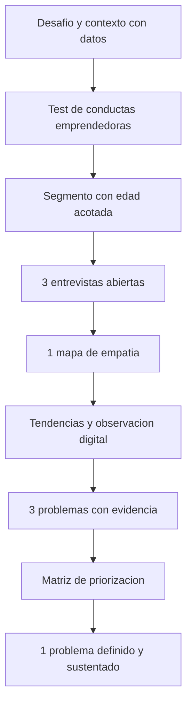
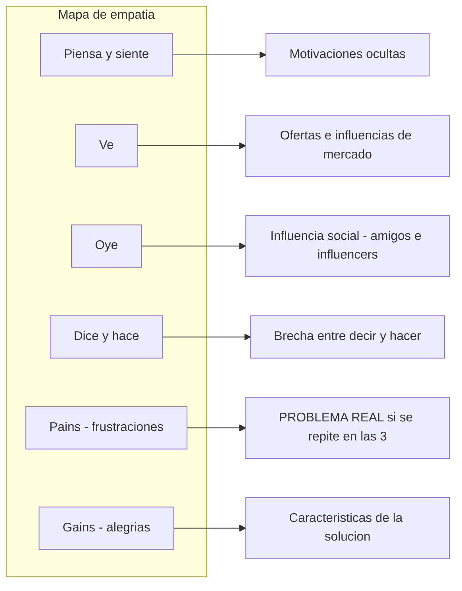
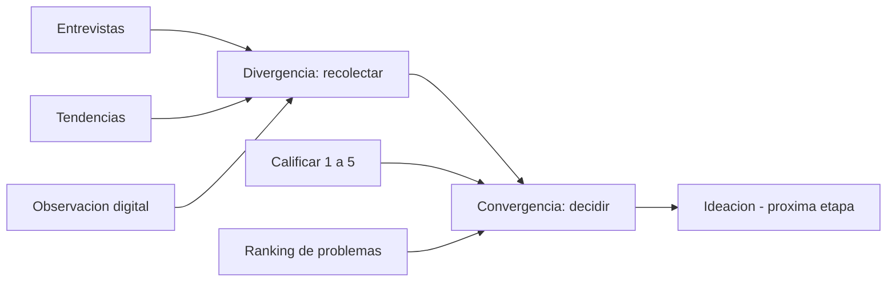
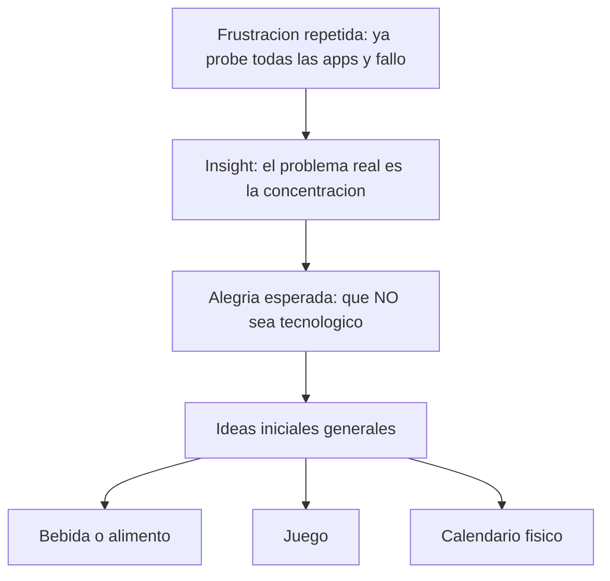

# Semana 5 — Del mapa de empatía al problema definido: entrevistas, segmento y portafolio APB1

**Curso:** Emprendimiento — UTPL (C11) · **Docente:** Andrés Tinajero
**Sesión:** martes 4 de noviembre de 2026 (~44 min de audio, dada en feriado)
**Fuente principal:** transcript de la clase (`EMPRENDIMIENTO-WEEK5-20261104_transcript.txt`).
**Notas de fuente:** esta semana no hay documento de diapositivas de referencia (no se usan etiquetas [D] ni [P]). Toda la clase gira en torno a la resolución de dudas sobre el portafolio y al mapa de empatía aplicado. Las etiquetas **[I]** marcan inferencia propia; el resto proviene del transcript, con marca de tiempo aproximada cuando aporta ubicación.

---

## 1. Síntesis ejecutiva

La sesión fue esencialmente **práctica y de acompañamiento**: el docente resolvió dudas concretas de Miriam, Erika y Brian mientras recorría, sección por sección, el portafolio APB1 (*Aprendizaje Práctico Experimental*), disponible hasta el **15 de noviembre, 23:59**. El hilo conductor: **antes de pensar en productos hay que delimitar un segmento con edad específica, entrevistar en profundidad y dejar que el mapa de empatía revele el problema real**.

Las ideas con mayor peso de la clase:

1. El segmento se define con **rango de edad acotado (5–6 años máximo como ejercicio académico)**, porque en ese tramo cambian comportamientos, gustos y capacidad de pago.
2. La entrevista es **cualitativa y abierta** (5–10 preguntas, más 4 de reserva); no se revela nunca el producto que se tiene en mente: se busca la **necesidad oculta**.
3. Si varias entrevistas devuelven respuestas de sí/no sin información, **el problema escogido no es real o relevante para ese cliente** — hay que reelegirlo, no forzar la entrevista.
4. En el mapa de empatía, **las frustraciones (pains) son donde aparece el problema real**; una frustración que se repite en las tres entrevistas es un problema. Las alegrías (gains) revelan **características** que debería tener la solución.
5. El flujo del portafolio va de **divergencia** (recolectar: 3 entrevistas, tendencias, observación digital, 3 problemas) a **convergencia** (priorizar con una matriz y definir **un solo problema** sustentado con datos y fuentes).

El docente cerró con dos ejemplos resueltos: el joven con problema de concentración (del que se deriva una solución no tecnológica) y el mapa de empatía de Carlos (52 años, diabetes tipo 2), que termina en un servicio de salud por suscripción. Subrayó que el mapa de empatía es el puente hacia la **propuesta de valor** y el **modelo de negocios**, y que la IA puede usarse para **ilustrar** la información recolectada, nunca para inventarla.

---

## 2. Ideas esenciales

### 2.1 El segmento se delimita con edad concreta, no con categorías masivas

- **Idea:** elegir "jóvenes" no basta; hay que decidir edad (p. ej. 19–25) porque de 15 a 18 "aún no pagan", y de 25 para arriba ya se les denomina *adultos jóvenes* (0:50–1:42, 8:00–8:30).
- **Por qué importa:** con **capital limitado** no se puede atacar un mercado masivo; el foco permite enfocar recursos, tiempo e investigación en el cliente **más afectado por el problema** (15:00–16:00).
- **Relaciones:** se conecta con la regla del rango de edad (2.2) y con la lógica del portafolio: el ejemplo mejor valorado de segmento es "niños de 6 a 11 años", frente a segmentos masivos como "adultos mayores" o "emprendedores" (19:15–20:10).
- **Ejemplo:** a Erika, que había puesto "estudiantes universitarios", el docente le pide una edad específica y sub-segmentar: ¿estudiantes que cursan, que están en el colegio o que están por graduarse? ¿A cuál de los tres les duele más el problema? (16:00–16:10).
- **Matiz importante [I]:** enfocar el segmento no significa rechazar ventas fuera de él: si llega un adulto de 35 años a comprar, "le vendo porque eso es ingresos", pero no se invierte esfuerzo económico ni de tiempo en buscarlo (15:15–15:35).

### 2.2 Regla del rango de edad: máximo 5–6 años

- **Idea:** como recomendación académica, el rango no debe superar **5–6 años**; existen recomendaciones de hasta 2 años por los "cambios tan abruptos" entre edades, pero para el ejercicio se pide 5–6 (8:05–8:30).
- **Por qué importa:** garantiza homogeneidad en la muestra de entrevistas: si ya entrevisté a alguien de 20, puedo entrevistar a uno de 25, **pero no a uno de 35** — "son dos personas totalmente opuestas" (8:30–8:45).
- **Relaciones:** corrige en vivo el caso de Miriam, que había hablado de 25–30 y luego entrevistó a un joven de 20: el docente reajusta el rango a **19–25** (7:50–8:00).
- **Ejemplo:** el mismo criterio aplica al ejemplo del portafolio ("niños de 6 a 11 años").

### 2.3 Entrevistar es descubrir necesidades ocultas, no validar el producto

- **Idea:** al entrevistar **no se dice qué producto o servicio se tiene en mente**; se pregunta qué piensa, ve, oye y hace el cliente para identificar la **necesidad oculta** (2:00–3:00).
- **Por qué importa:** el dato superficial ("me estreso") no basta; hay que "llegar lo más a fondo posible" porque "muchas veces los dolores que nos dicen son superficiales" (7:05–7:15).
- **Relaciones:** conecta con la idea de que las frustraciones contienen el problema real (2.7) y con la advertencia de que una sola entrevista no basta (2.4).
- **Ejemplo:** de la necesidad oculta "con el dispositivo nunca descansas, duermes con el celular al lado, estás conectado 24-7" puede nacer —sin haberlo preguntado como producto— un **té relajante nocturno** con plantas medicinales ecuatorianas para desconectarse antes de dormir (3:10–3:50).

### 2.4 Una entrevista no alcanza: profundidad y volumen

- **Idea:** "si nos quedamos en una entrevista, no vamos a llegar a saber en verdad qué está pasando"; se requieren las **3 entrevistas** del portafolio (7:25–7:40 y 14:00–14:10).
- **Por qué importa:** permite distinguir causas parecidas: ¿es desorganización de tareas o **hiperconectividad** que impide concentrarse? (7:15–7:25).
- **Relaciones:** alimenta la matriz de priorización de problemas (2.9) y la regla de la frustración repetida (2.7).
- **Ejemplo:** la entrevista de Miriam a un joven de 20 años (dificultad para organizar el tiempo por estudios y redes sociales; deja la tarea para el final; ansiedad, estrés y bajo rendimiento académico) fue validada como buen inicio, con la indicación de profundizar más (6:00–7:05).

### 2.5 Entrevista ≠ encuesta; número y manejo de preguntas

- **Idea:** la encuesta es **cuantitativa**; aquí se necesita **información cualitativa** vía preguntas abiertas: como ejercicio, **4–5 preguntas** directas (el docente menciona también "5 a 10" como referencia general), sin contar los datos preliminares (nombre, edad, sector) (14:00–14:35).
- **Por qué importa:** hay usuarios que responden en una palabra ("¿cómo se siente con las lluvias? — Mal"); por eso conviene llevar **4 preguntas adicionales de reserva** y, si el cliente solo dice sí/no, **cerrar la entrevista con cortesía, agradecer y no validar** esa respuesta: las grandes empresas simplemente no la dan por válida porque necesitan que el cliente dé información (14:35–15:00 y 11:00–11:40).
- **Relaciones:** la señal de muchas entrevistas pobres apunta a un problema mal escogido (2.6).
- **Ejemplo de técnica:** para el cuadrante "dice y hace" no se pregunta "¿eso que dice lo hace de verdad?"; se pregunta qué hace actualmente frente al problema y **con qué frecuencia lo hace cotidianamente** (31:40–32:15).

### 2.6 Diagnóstico: cuando nadie da información, el problema no es real

- **Idea:** si **varias** entrevistas devuelven sí/no sin contenido, "el problema no es real, no está siendo relevante para el cliente"; si solo pasa en una, el cliente no tuvo tiempo y conviene buscar otro (13:40–14:00).
- **Por qué importa:** evita construir sobre un problema inexistente y ahorra el esfuerzo del semestre.
- **Relaciones:** es el contrapunto de la regla de oro del Design Thinking visto en la semana 3: empatizar antes de solucionar.
- **Ejemplo (contraste):** mojarse al cruzar la calle con lluvia **no** es un problema relevante (llego a casa y me seco; verifico el clima y llevo paraguas o chompa) y por eso no da información; el **tráfico de Quito** sí lo es: genera molestia, ira, llegadas tarde y, con ello, abundante información (12:00–13:40).

### 2.7 Deseos y miedos se mapean por separado — y llevan a productos distintos

- **Idea:** no es lo mismo un **deseo** ("me gustaría no estar conectado a las 11 de la noche") que un **miedo** ("dormir con el celular al lado y que me dependa/engancha" — audio parcial, ver §8); "se mapea en dos escenarios totalmente diferentes" y cada uno puede originar un producto diferente (5:35–6:00).
- **Por qué importa:** el mapa de empatía separa ambos bloques precisamente para no mezclar motivaciones.
- **Relaciones:** pains/frustraciones vs. gains/alegrías en la estructura del mapa; los deseos alimentan las características esperadas (2.8).
- **Ejemplo:** respecto al mismo problema de sueño, un entrevistado puede decir que le recomendaron aceite de CBD; los influencers que sigue pueden recomendar "apagar de noche" o "una cajita para guardar el celular": eso que le recomiendan su entorno es insumo del cuadrante "oye" (4:15–5:05).

### 2.8 Anatomía del mapa de empatía como guía de entrevista

- **Idea:** cada cuadrante tiene un propósito y por tanto una pregunta-tipo (33:30–36:20):

| Cuadrante | Qué se pregunta (ejemplos del docente) | Qué revela |
|---|---|---|
| **Piensa y siente** | ¿Qué le preocupa **respecto al problema**? ¿Cuáles son sus sueños y miedos respecto a…? (anclado al problema, no filosófico) | Motivaciones intrínsecas, la parte oculta |
| **Ve** | ¿Qué ofertas ve en el entorno/competencia para solventar ese problema? | Ambiente visual, influencias de mercado |
| **Oye** | ¿Qué dicen sus amigos, los influencers que sigue? | Influencia social y profesional |
| **Dice y hace** | No se pregunta directo: se infiere de "¿qué haces actualmente?" + "¿con qué frecuencia lo haces?" | Discrepancia entre lo que piensa y cómo actúa |
| **Frustraciones (pains)** | ¿Qué le molesta? ¿Qué obstáculos o riesgos enfrenta? | **Aquí se descubren los problemas reales** |
| **Alegrías (gains)** | ¿Qué espera ganar? ¿Qué le haría la vida más fácil o mejor? | Beneficios esperados → **características** del producto/servicio |

- **Por qué importa:** da estructura a la entrevista ("no siempre tienen que ser las mismas preguntas; hay que acomodarlas a lo que ustedes quieren averiguar") y evita el error clásico de preguntar mal ("¿qué te preocupa?" a secas es "sumamente filosófico").
- **Relaciones:** los insights del mapa (qué descubrieron, qué podrían mejorar, ideas iniciales) alimentan la definición del problema (2.9).
- **Ejemplo (repetición = señal):** si en las tres entrevistas todos dicen que no manejan bien el tiempo, que ya probaron todos los aplicativos y siempre fallan, el problema real **no es la falta de notificaciones sino la falta de concentración** ("se concentran 5 o 10 minutos") (34:30–35:00).

### 2.9 Del portafolio: de divergir (recolectar) a converger (definir un problema)

- **Idea:** el portafolio APB1 reproduce el ciclo Design Thinking: primero **divergencia** (mucha información) y luego **convergencia** (elegir). Flujo completo según lo mostrado en pantalla (16:20–29:00):
  1. Desafío seleccionado (p. ej. "vivir mejor" / estrés por redes) y **contexto** de lo que se desea explorar — **enriquecido con datos** de fuentes (el docente lo ilustra con un dato hipotético tipo UNESCO sobre estudio en línea; ver §8).
  2. Cuestionario de conductas emprendedoras + captura de pantalla.
  3. Selección del segmento (con edad).
  4. **3 entrevistas** (nombre y perfil: sexo, edad, información relevante y curiosa — "no es relevante que tenga frío; todos tienen frío" —; por anonimato, nombre e inicial).
  5. **Un solo mapa de empatía** elaborado a partir de las tres entrevistas; debe "crecer" con la información, incluyendo insights, oportunidad detectada e ideas iniciales sin elaborar.
  6. **Exploración de tendencias:** tabla tendencia → evidencia (link/documento) → necesidad o problema que podría generar.
  7. **Observación digital:** recorrer redes sociales (p. ej. comentarios en publicaciones de Facebook de bastones o andadores): problema frecuente que se repite, necesidad no resuelta, queja/frustración de material, deseo o aspiración ("algo que se sienta más propio").
  8. **Tres problemas o necesidades** en tabla: problema, quién es el usuario, cómo le afecta, posibles causas y evidencia — extraídos de entrevistas + observación digital.
  9. **Matriz de priorización** para elegir: se califica de 1 a 5 según **tamaño, entusiasmo e instinto** (términos según el audio, ver §8) y se obtiene un ranking; se adjunta **una ficha por cada problema** como evidencia de cuál se escogió.
  10. **Definición del problema final** sustentada con información y fuentes (el docente menciona "datos del INE", ver §8), incluyendo de dónde salieron.
- **Por qué importa:** no se pueden quedarse con los tres problemas — "si no, voy a hacer 60 productos al final del semestre" (27:40–28:10). El problema definido con evidencia es la base de todo lo que sigue.
- **Relaciones:** la convergencia aquí es la antesala de la **ideación** (siguiente etapa del curso).
- **Ejemplo:** para el caso de adultos mayores: insight = miedo a caerse (tren superior); oportunidad = **no hay productos para el tren superior** (solo bastón, andadera, rodillera: "todo de las piernas"); idea inicial (general, sin detalles) = una chompa… [audio distorsionado, ver §8].

### 2.10 La oportunidad no es el producto: es la brecha

- **Idea:** en el apartado de insights, la "oportunidad" que se pide **no es la idea de producto** sino la **brecha detectada tras investigar**: "la oportunidad es que no hay productos" (24:10–24:40).
- **Por qué importa:** mantiene el orden del método: primero evidenciar el vacío, recién después idear.
- **Relaciones:** se conecta con la regla de "ideas iniciales súper generales, sin detalles ni características".
- **Ejemplo:** "productos para adultos mayores del tren superior no hay; y si los hay, hay muy pocos" → recién ahí cabe una idea inicial abierta.

### 2.11 Uso responsable de la IA en el portafolio

- **Idea:** se recomienda pedirle a la IA que **arme la infografía** a partir de la información ya recolectada por el estudiante, con una nota del tipo "elaborada a partir de información recolectada; la ilustración es desarrollada por la IA" [el audio dice "por Talia"; ver §8] (24:50–25:20 y 36:00–36:40).
- **Por qué importa:** "no tenemos que pedirle que nos dé la información", sino ahorrar tiempo de plantillas para invertirlo **en el proceso de investigación**.
- **Relaciones:** coherente con la regla de la semana 3 de sustentar todo en datos verificados, no en "yo creo que…".
- **Ejemplo:** el mapa de empatía mostrado (Carlos) es información recolectada con infografía generada por IA.

### 2.12 El mapa de empatía como puente hacia la propuesta de valor y el modelo de negocio

- **Idea:** conclusión de la clase: usar el mapa de empatía al desarrollar un producto o servicio es "estrategia para el desarrollo", busca el **ajuste al mercado**, se convertirá en un recurso completo que "facilitará el desarrollo de la propuesta de valor" y es "complemento ideal para la creación del modelo de negocios" (materia de otra asignatura, cuando ya se pasó por ideación, prototipo, etc.) (38:30–39:30).
- **Por qué importa:** el enfoque final de la herramienta es que lo que se ofrezca "le aporte valor a la vida cotidiana" del cliente.
- **Relaciones:** cierra el arco de las semanas 3–5: empatizar → identificar → (idear → diseñar → validar).
- **Ejemplo:** del mapa de Carlos nace una característica concreta del servicio: plan tipo suscripción ("casi como Netflix, pero de atención de salud") con médico fijo y pagos con descuento automático.

---

## 3. Mapa conceptual

### 3.1 Flujo general del portafolio APB1

### 3.2 Qué revela cada cuadrante del mapa de empatía

### 3.3 Divergencia → convergencia

### 3.4 De la frustración repetida al producto (caso jóvenes)

*Nota de sintaxis: se evitan tildes y signos especiales dentro de los nodos Mermaid para garantizar el renderizado.*

---

## 4. Notas (información administrativa y de logística)

1. **Portafolio APB1** (*Aprendizaje Práctico Experimental* 1): disponible **hasta el 15 de noviembre, 23:59**. Una estudiante creía que era hasta el 8; el docente lo verificó en pantalla (42:20–42:35).
2. **Rúbrica de la primera calificación (sobre 10)** (28:40–29:05):
   - Captura de pantalla del test/cuestionario de conductas emprendedoras: **1 punto**.
   - Contenido que demuestra investigación, revisión y lectura previa del material: **2 puntos**.
   - El portafolio: **2.5 puntos** — se evalúa si se contemplaron todos los apartados, si el problema está bien contextualizado, si está claro y **sin faltas de ortografía**.
3. **Evidencia de las entrevistas:** pueden hacerse por llamada o videollamada de WhatsApp con **captura de pantalla con el tiempo de la llamada** (idealmente una al inicio y otra antes de cerrar). **Recomendación del docente: Zoom** — la licencia gratuita da 40 minutos por reunión, y "con 30 minutos es una entrevista más que suficiente" (40:00–41:30). En caso de duda sobre si la captura es aceptable, consultar al docente de acompañamiento (hay tiempo hasta el 15).
4. **Anonimato:** en las entrevistas, nombre e inicial del apellido (p. ej. "Andrés T.").
5. **Dudas:** escribir por la mensajería del LMS ([Levia/Lea] — nombre de la plataforma según audio, ver §8); el docente de acompañamiento responde desde el día siguiente.
6. **Clase en feriado:** el docente dio la clase normal pese al feriado y no dejó anuncio de suspensión; la grabación quedará disponible para quien la necesite (43:10–43:40).
7. **Bootcamp presencial:** sábado **14 de noviembre**; quienes no puedan asistir presencialmente tendrán **videocolaboración la siguiente semana** (semana del 9 al 15 de noviembre, coherente con lo informado en la semana 3, actividad con peso del 35 %); quienes asistan presencialmente al bootcamp no tendrían que asistir el siguiente martes (43:40–44:00).
8. **Confirmación por ciudad:** a los inscritos (Miriam, Erika, Brian) les llegarán por correo la confirmación de participación en las ciudades del bootcamp, y habrá un anuncio en el aula virtual (44:05–44:15).
9. **Dato del docente sobre su disponibilidad:** cuando hay feriado y tiene tiempo, da la clase normal — por eso no hubo anuncio de cancelación.

---

## 5. Aplicación: los casos trabajados en clase

### 5.1 Caso guiado: jóvenes y sobrecarga digital (del problema al producto)

Recorrido completo que el docente improvisó a partir de la duda de Miriam (0:00–4:00 y 34:00–36:00):

| Paso | Contenido |
|---|---|
| Problema inicial | Estrés/ansiedad por el uso de redes sociales ("sobrecarga digital") |
| Segmento | Jóvenes; se reajusta a **19–25 años** tras enterarse de que el entrevistado tenía 20 |
| Necesidad oculta detectada | "Con los dispositivos nunca descansas: duermes con el celular al lado, pasas conectado 24-7" |
| Posible solución (solo ilustrativa) | Té relajante nocturno con plantas medicinales ecuatorianas; tomarlo 10 min antes de dejar el celular; mejor calidad de sueño |
| Frustración repetida (3 entrevistas) | "Probé todos los aplicativos y siempre acabo haciendo algo mal" |
| Reinterpretación [I: inferencia explícita del docente] | El problema real **no es la falta de notificaciones**: es que **no se concentran** (5–10 minutos) |
| Alegría esperada → característica | "Que no sea tecnológico": es paradójico que el celular te diga cuándo no usar el celular → la solución no debe vivir en el celular (bebida, alimento, juego, calendario…) |

**Lección:** el producto final (el té) nunca se preguntó en la entrevista; emergió de la necesidad oculta. Y la característica "no tecnológico" no salió del docente sino de las **alegrías** del mapa.

### 5.2 Caso mostrado en pantalla: Carlos, 52 años, diabetes tipo 2

Mapa de empatía de ejemplo (con infografía generada con IA) (36:40–38:30):

- **Contexto:** busca atención integral sin descuidar su trabajo.
- **Problemas detectados:** pérdida de tiempo, gasto imprevisto y **falta de continuidad en la atención médica** — identificado como el más grave: "te atiende un doctor, luego otro y otro", cuando el paciente necesita justamente continuidad.
- **Necesidades/alegrías:** atención integral, agilidad, **transparencia financiera**.
- **Característica derivada para el servicio:** plan tipo **suscripción** — "casi como tener una plataforma Netflix, pero de atención de salud" — con el mismo médico siempre y pagos que se descuentan de una cuenta en lugar de pagar cada visita.

**Lección:** el mapa no solo diagnostica; al cruzar frustraciones (problemas) con alegrías (expectativas) produce **especificaciones** de la futura propuesta de valor.

### 5.3 Mini-caso de método: la entrevista "vacia" y el problema mal escogido

Ejercicio de diagnóstico del docente (12:00–14:00): ante la pregunta por un problema cotidiano (mojarse con la lluvia al cruzar la calle), el entrevistado responde "me siento a veces molesto, pero llego y me seco; debo verificar el clima y llevar paraguas". Conclusión del docente: no hay información porque **el problema no le resulta relevante**. En cambio, preguntar a un quiteño por el tráfico produce información abundante (molestia, ira, llegadas tarde). **Regla operativa:** muchas entrevistas sin contenido → cambiar de problema; una sola entrevista sin contenido → buscar otro entrevistado.

---

## 6. Preguntas de profundización

1. ¿Por qué un rango de edad demasiado amplio (p. ej. 18–35) compromete la validez de las tres entrevistas y del mapa de empatía resultante?
2. Si una frustración aparece en las tres entrevistas pero contradice lo que el cliente declara en "dice y hace", ¿cuál de las dos señales debería pesar más al definir el problema, y por qué?
3. La matriz de priorización califica tamaño, entusiasmo e instinto de 1 a 5: ¿qué riesgos tiene dejar la decisión final al "instinto", y cómo lo mitiga la exigencia de evidencia en cada ficha de problema?
4. En el caso de Carlos, la "oportunidad" era la falta de continuidad médica, no la app de suscripción. ¿Qué se pierde un emprendedor que salta directamente de la frustración al producto?
5. La regla de "no validar respuestas de sí/no" imita lo que hacen las grandes empresas: ¿cómo se aplicaría ese mismo criterio al revisar las propias notas de campo después de cada entrevista?
6. El docente sugiere usar IA para la infografía pero no para la información: ¿dónde está exactamente la línea entre "apoyarse en IA" y "delegar la investigación"?

---

## 7. Glosario

- **APB1 (Aprendizaje Práctico Experimental):** primer portafolio práctico del curso; incluye desafío, contexto, test de conductas emprendedoras, segmento, entrevistas, mapa de empatía, tendencias, observación digital y definición del problema.
- **Mapa de empatía:** herramienta que organiza lo que el usuario piensa y siente, ve, oye, dice y hace, más sus frustraciones (pains), alegrías (gains) e insights; en el portafolio se elabora **uno solo** a partir de las tres entrevistas.
- **Necesidad oculta:** necesidad que el cliente no verbaliza de entrada y que solo aparece al profundizar en la entrevista (p. ej. "nunca descansas, duermes con el celular al lado").
- **Hiperconectividad:** estado de estar conectado en permanencia (24-7); en clase, causa alternativa a la "desorganización" como raíz del mal rendimiento estudiantil.
- **Entrevista (vs. encuesta):** instrumento cualitativo de preguntas abiertas para obtener información; la encuesta es cuantitativa y no es la que pide el portafolio.
- **Insight:** punto clave o descubrimiento que emerge del mapa de empatía (qué se descubrió, qué se podría mejorar, ideas iniciales).
- **Pains / frustraciones:** molestias, obstáculos y riesgos del usuario; **su repetición en las tres entrevistas señala el problema real**.
- **Gains / alegrías:** lo que el usuario espera ganar o lo que le haría la vida más fácil; se traducen en **características** del futuro producto o servicio.
- **Oportunidad (brecha):** vacío detectado tras investigar (p. ej. no existen productos para el tren superior del adulto mayor); **no** es el producto.
- **Observación digital:** revisión de publicaciones y comentarios en redes sociales para detectar problemas recurrentes, necesidades no resueltas, quejas de material y deseos.
- **Divergencia / convergencia:** fases del Design Thinking; en empatizar se diversifica información, en definir se escoge un único problema.
- **Matriz de priorización:** tabla para calificar problemas de 1 a 5 (tamaño, entusiasmo, instinto) y obtener un ranking que decide cuál problema se define.
- **Adulto joven:** denominación que reciben los jóvenes de 25 años en adelante, relevante para no mezclarlos con el segmento de 19–25.
- **Videocolaboración:** sesión virtual (semana del 9 al 15 de noviembre, 35 % de la nota) para quienes no asistan al bootcamp presencial del sábado 14.
- **Bootcamp:** jornada presencial del programa en distintas ciudades, confirmada por correo a los inscritos.

---

## 8. Cobertura y límites

**Cobertura.** El documento cubre el 100 % de los 44 minutos de audio de la clase del 4 de noviembre de 2026: la resolución de dudas de las tres estudiantes que participaron (Miriam, Erika, Brian), el recorrido completo del portafolio APB1 proyectado en pantalla, la guía de preguntas del mapa de empatía, los dos casos resueltos (jóvenes/concentración y Carlos/diabetes) y toda la información administrativa (fechas, rúbrica, evidencias, bootcamp).

**Límites.**

1. **Única fuente:** esta semana no se dispone del documento de diapositivas/notas ni de un documento de "pregunta clave"; todo lo no marcado como [I] proviene del transcript. Las tablas y listas del portafolio se reconstruyen de la narración verbal del docente mientras compartía pantalla: el texto exacto de la plantilla puede diferir levemente.
2. **Audio:** hay palabras distorsionadas o dudosas; se listan con su ubicación en la sección final de ambigüedades (§9), que es **aparte** del resto del documento como se solicitó.
3. **Datos ilustrativos:** el dato "50–55 % de estudiantes estudian en línea (UNESCO)" fue presentado por el docente como **ejemplo hipotético** ("supongamos") de cómo enriquecer el contexto, no como cifra verificada; no debe citarse como real.
4. **Participación parcial:** las dudas de otros compañeros no audible/asientos fuera de micrófono no están representadas; el documento refleja lo registrado.
5. **Fechas:** las fechas (15/11 23:59, sábado 14, videocolaboración semana del 9–15) son las dichas en clase; conviene confirmarlas en el aula virtual por si hay cambios.

---

## 9. Ambigüedades y puntos a verificar (sección aparte)

> Ubicaciones exactas de cada ambigüedad, separadas del resto del documento según lo solicitado. Ninguna de estas dudas afecta las ideas centrales de la clase.

| # | Ubicación en el transcript | Texto/audio | Problema y lectura probable |
|---|---|---|---|
| 1 | 23:12–23:20 (~1392–1396 s) | "puede ser **la chompa e irba**" | Fragmento distorsionado. Contexto: idea inicial, general y sin detalles, de prenda para el tren superior del adulto mayor. Podría ser "chompa térmica" u otra prenda; **no se puede determinar**. Se dejó señalado en §2.9. |
| 2 | 23:45–23:50 (~1424–1429 s) | "la ilustración es desarrollada por **Talia**" | Casi con seguridad es "por **la IA**" (el docente estaba explicando justamente generar la infografía con inteligencia artificial). Transcrito literalmente en §2.11 con la corrección señalada. |
| 3 | 27:55–28:00 (~1677–1680 s) | matriz: "**tamaño, el entusiasmo, el instinto**" | Criterios de la matriz de priorización según lo que se alcanzó a oír. "Entusiasmo" e "instinto" son términos usados por el docente, pero la plantilla proyectada no es legible en el audio; verificar los nombres exactos de los criterios en el documento del portafolio. |
| 4 | 28:30 (~1708–1712 s) | "buscan datos del **INE**" | En Ecuador el instituto de estadística es el **INEC** (Instituto Nacional de Estadística y Censos). El docente dijo "INE"; se asume que se refería al INEC [I]. |
| 5 | 31:25 (~1885 s) | "¿qué dicen sus amigos, **Genfers**?" | Palabra ininteligible (¿"líderes", "youtubers", "influencers"?). El propio docente continúa hablando de influencers, por lo que el sentido del cuadrante "oye" queda claro aunque la palabra exacta no. |
| 6 | 4:30 (~270 s) | "**en el que vea** hay que tener en cuenta" | Frase truncada; por contexto: "en el que **vean**" (el entorno visual del cliente). No afecta el contenido. |
| 7 | 14:00–16:00 (~558–584 s) | "entre **5 a 10** preguntas" → "con unas **4 o 5** como ejercicio" → "si llegan con **5 o 6**, tener **4 adicionales**" | El docente dio tres cifras en el mismo pasaje. Síntesis fiel: 5–10 preguntas abiertas como referencia general; 4–5 directas como ejercicio del portafolio; más 4 de reserva para usuarios poco colaborativos. Verificar el número exigido en la plantilla del APB1. |
| 8 | 18:40 (~1121 s) | "un documento del **UNESCO**… el **50 % o 55 %** de estudiantes estudian en línea" | Cifra **hipotética**, dicha como ejemplo ("supongamos") de cómo dar contexto con datos. No citar como dato real sin verificar la fuente. |
| 9 | 7:45–8:30 (~475–512 s) | rango de edad: "**5 o 6 años**" académico vs. "no más allá de **2 años**" según otras recomendaciones | El docente menciona ambas cifras y las distingue explícitamente (2 años en la práctica profesional, 5–6 por tema académico). No es contradicción, pero conviene no citarlas mezcladas. |
| 10 | 43:55 (~2630 s) | bootcamp "el **sábado 14**" y videocolaboración "la **siguiente semana**" | Diciéndolo rápido, la relación entre ambas queda algo enredada ("para los que no puedan asistir presencialmente al bootcamp… la siguiente semana… no tendrían que asistir el siguiente martes"). Lectura probable: bootcamp presencial sábado 14/11; videocolaboración la semana del 9–15/11 para los no presenciales; los que van al bootcamp no necesitan la sesión del martes siguiente. Confirmar en el anuncio del aula virtual. |
| 11 | 42:20–42:35 (~2545–2553 s) | "**APB1**… disponible hasta el **15 de noviembre** de 23.59" | La estudiante tenía entendido el 8 de noviembre. El docente mostró en pantalla el 15. Queda registrada la diferencia por si el aula virtual muestra otra fecha a otros paralelos. |
| 12 | 41:10 (~2476 s) | nombre de la plataforma de mensajería: "**leva**" | Probablemente el LMS de la UTPL (audio poco claro). La instrucción (escribir dudas por la mensajería del aula virtual al docente de acompañamiento) es inequívoca. |
| 13 | 5:45 (~334 s) | "me decante" (miedo a que, por dormir con el celular al lado, "me decante") | Verbo poco claro en el audio (¿"me dé cuenta"?, ¿"me dependa"?, ¿"me desvele"?). El sentido general (miedo asociado a dormir junto al celular) sí es claro; la palabra exacta, no. |
